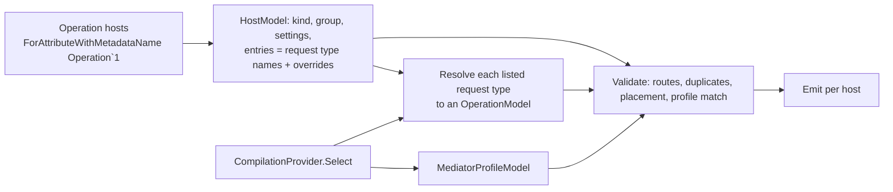

# Mediator-agnostic API generators: orientation, design and plan

Status: **phases 1–3 built 2026-11-08.** Phase 1: base package, Minimal API, HTTP client, all six profiles, functional and AOT tests, guide. Phase 2: controller hosts (the old controller generator and `RestfulApiController` removed, the Restful samples migrated) and code-first gRPC server and client hosts. Phase 3: GraphQL mutation hosts and clients (queries left out, decided 2026-11-08), the old mutation generator removed, Sample.Graphql migrated. Server-side API versioning built for Minimal API and controller hosts (6). Phase 4 decided, not built (5).

Related: [ADR-0002 one package per integration](../adr/0002-package-per-integration.md), [ADR-0003 explicit operation hosts](../adr/0003-explicit-operation-hosts.md), and the terms _operation_, _operation host_, _group_, _transport_, _contracts project_ and _mediator profile_ in [GLOSSARY.md](../../GLOSSARY.md).

Contents:

1. [Orientation: how LaunchPad's generators work today](#1-orientation-how-launchpads-generators-work-today)
2. [ChannelMediator review](#2-channelmediator-review)
3. [Things in LaunchPad that fight this design](#3-things-in-launchpad-that-fight-this-design)
4. [Design](#4-design)
5. [Phase plan](#5-phase-plan)
6. [Decisions and open items](#6-decisions-and-open-items)

---

## 1. Orientation: how LaunchPad's generators work today

| Topic                   | What LaunchPad does                                                                                                                                                                                                                                                                                                                                                                                                                                                                                                      |
| ----------------------- | ------------------------------------------------------------------------------------------------------------------------------------------------------------------------------------------------------------------------------------------------------------------------------------------------------------------------------------------------------------------------------------------------------------------------------------------------------------------------------------------------------------------------ |
| Generator project       | One project, `src/Analyzers/Rocket.Surgery.LaunchPad.Analyzers.csproj`, `netstandard2.0`, `EnforceExtendedAnalyzerRules`, `Polyfill` for newer BCL APIs.                                                                                                                                                                                                                                                                                                                                                                 |
| Roslyn version          | Generator compiles against `Microsoft.CodeAnalysis.CSharp` **5.0.0** (`VersionOverride`, the compiler in the .NET 10 SDK) so it loads on both the .NET 10 and .NET 11 SDKs. Tests use 5.9.0. `ForAttributeWithMetadataName` and `AddEmbeddedAttributeDefinition` are available.                                                                                                                                                                                                                                          |
| Generators in it        | `ControllerActionBodyGenerator` (fills user-written `partial` actions on `RestfulApiController` subclasses), `GraphqlMutationActionBodyGenerator` (fills `partial` resolvers), `PropertyTrackingGenerator`, `GraphqlOptionalPropertyTrackingGenerator` (generates `Optional<T>` members and `Create()` on `IOptionalTracking<T>` inputs), `InheritFromGenerator`, `MutableGenerator`. All are `IIncrementalGenerator`, but they pass `SemanticModel`/`ISymbol` to the output step and build output with `SyntaxFactory`. |
| Attribute packaging     | No separate attributes package. Attributes are hand-written public types in `Rocket.Surgery.LaunchPad.Foundation` or emitted with `RegisterPostInitializationOutput`.                                                                                                                                                                                                                                                                                                                                                    |
| How the generator ships | **Inside `Rocket.Surgery.LaunchPad.Foundation`**, which depends on `MediatR`, `Joinery.Dovetail` and `Specular`. The analyzer's `_LaunchPadPackAnalyzer` target packs the DLL to `analyzers/dotnet/cs`.                                                                                                                                                                                                                                                                                                                  |
| Diagnostics             | `GeneratorDiagnostics`: `LPAD0001`–`LPAD0008`, category `"LaunchPad"`. No `AnalyzerReleases.*.md` tracking. No code fixes anywhere in the repo.                                                                                                                                                                                                                                                                                                                                                                          |
| Tests                   | `test/Analyzers.Tests` (TUnit on MTP, `net10.0;net11.0`). `GeneratorTest : LoggerTest<TestRecord>` builds a `GeneratorTestContextBuilder` (`Rocket.Surgery.Extensions.Testing.SourceGenerators` 11.0.1, which supports code fixes but has no incremental step tracking) in a collectible `AssemblyLoadContext`. Snapshots via `Verify.SourceGenerators` in `test/Analyzers.Tests/snapshots/`, named `{Type}.{Method}`, file version scrubbed. Sample functional tests use `WebApplicationFactory`.                       |
| Target frameworks       | Everything `net10.0;net11.0` (SDK 11 RC via mise). Generators `netstandard2.0`.                                                                                                                                                                                                                                                                                                                                                                                                                                          |
| Package naming          | `Rocket.Surgery.LaunchPad.{Area}`, one package per integration (ADR-0002). Existing transport packages: `…AspNetCore`, `…Grpc` (proto-based), `…HotChocolate`, `…StrawberryShake`.                                                                                                                                                                                                                                                                                                                                       |
| Wiring                  | Dovetail joints. `MediatRJoint` registers MediatR and every handler in assemblies that reference MediatR (found through Specular).                                                                                                                                                                                                                                                                                                                                                                                       |
| Public API tracking     | `WarningsAsErrors=RS0017`, but no `PublicAPI.Shipped.txt` files and no PublicApiAnalyzers reference, so RS0017 never fires. Public types carry `[PublicAPI]`.                                                                                                                                                                                                                                                                                                                                                            |
| Docs                    | Astro Starlight in `docs/` (`docs/src/content/docs/{guides,concepts}`), ADRs in `docs/adr/`, glossary at the root.                                                                                                                                                                                                                                                                                                                                                                                                       |
| Mediator                | MediatR **12.5.0**. Requests are nested (`GetRocket.Request(RocketId Id) : IRequest<RocketModel>`), IDs strongly typed, missing entities throw `NotFoundException` and ProblemDetails turns it into 404. Patch operations are ordinary requests (`EditRocket.PatchRequest : IPropertyTracking<Request>, IRequest<RocketModel>`).                                                                                                                                                                                         |
| Local build             | `mise x -- dotnet …`; native `protoc` flags on Apple Silicon; `--coverage-settings test/coverage.runsettings`.                                                                                                                                                                                                                                                                                                                                                                                                           |

## 2. ChannelMediator review

Read: `GENERATORS.md`, `ChannelMediator.ApiGenerators.Abstraction/*`, and its four generators, commit `7ee954e` (2026-07-16).

**Kept:**

- Request types carry at most attributes; transports are generated in server and client projects.
- One mediator handler per operation on the client, so `mediator.Send(...)` reads the same on both sides.
- Verb inference from name prefixes, kebab-case paths, `IStreamRequest<T>` → NDJSON on HTTP and server streaming on gRPC.
- Code-first gRPC with a `[ServiceContract]` interface that client and server each generate, so the contracts project needs no gRPC reference.

**Replaced** (ADR-0003): ChannelMediator exposes every marked request found by scanning referenced assemblies (`[MapApiExtension]` marker class + `ScanAssemblies`, `[assembly: ApiClient(typeof(Marker))]`). LaunchPad instead requires each operation to be listed on an operation host.

**Avoided:**

| Problem in ChannelMediator                                                                                                   | Consequence                                       | What we do instead                                                                                    |
| ---------------------------------------------------------------------------------------------------------------------------- | ------------------------------------------------- | ----------------------------------------------------------------------------------------------------- |
| Every generator combines `CompilationProvider` into the output step and walks every referenced assembly's `GlobalNamespace`. | All output re-runs on every keystroke.            | No scanning: hosts name their operations. Models are equatable; output steps never see `Compilation`. |
| `EndpointApiInfo.Equals` compares only `RequestTypeName`; models hold `Location` and mutable lists.                          | Stale output after editing a `Path` or `Summary`. | `record` models with `EquatableArray<T>`; locations kept as non-equated `LocationInfo`.               |
| `IMediator`, `IRequest<T>`, `IRequestHandler<,>` hard-coded.                                                                 | Only works with ChannelMediator.                  | Mediator profiles (4.4).                                                                              |
| URLs built by string concatenation, unescaped, culture-sensitive.                                                            | Broken URLs, culture-dependent values.            | `Uri.EscapeDataString`, invariant formatting, relative URIs.                                          |
| `GetFromJsonAsync` + `return result!`.                                                                                       | 404 throws; nullable responses never `null`.      | Explicit status handling (4.6).                                                                       |
| Diagnostics redeclared per generator.                                                                                        | Colliding IDs.                                    | One descriptor table in the shared core.                                                              |

## 3. Things in LaunchPad that fight this design

1. **The old controller and GraphQL generators overlap.** They are MediatR-only, not cache-friendly, and depend on user-written partial signatures. **Decided:** replaced, one transport per phase (controllers in phase 2, GraphQL in phase 3), together with `RestfulApiController`'s MediatR plumbing. `GraphqlOptionalPropertyTrackingGenerator` stays, because `Input` types (4.3) are built with its `Create()`. Of their diagnostics only `LPAD0003` and `LPAD0004` are the controller generator's alone and retire with it; `LPAD0002` and `LPAD0005`–`LPAD0007` are shared with the generators that stay (corrected 2026-11-08). Retired IDs are not reused.
2. **The analyzer ships inside Foundation, which depends on MediatR.** **Decided:** new packages (4.1), following ADR-0002: a base package that emits the attributes, plus one package per transport.
3. **Attributes are emitted, not shipped.** They become per-compilation `internal` types marked `[Embedded]`, so contracts, servers and clients each get their own copy and nothing reaches runtime. The generator reads `[ApiOperation]` from referenced contracts by metadata name; **phase 1's spike must prove** that works on the .NET 10 and 11 compilers.
4. **Nested request names.** For `GetRocket.Request`, names come from the containing type when the type's own name is a role word (`Request`, `Command`, `Query`, `Message`). A non-nested `GetRocketRequest` drops the role suffix. Either way the operation is called `GetRocket`.
5. **Strongly typed IDs** need `IParsable<T>`/`TryParse` on the server and invariant formatting on the client, checked by the generator (LPAD1007).
6. **Not-found convention.** Handlers throw `NotFoundException`; the generators add null → 404 for nullable responses without depending on LaunchPad.Primitives. Clients map 404 → `null` only for nullable responses.
7. **Client exceptions.** With no runtime package, generated clients throw `HttpRequestException` (it has `StatusCode`) with the ProblemDetails text.
8. **`ServiceLifetime`** isn't available to dependency-free attributes, so the profile uses a generated `HandlerLifetime` enum.
9. **MediatR double registration.** `MediatRJoint` scans every assembly that references MediatR, so generated client handlers are also picked up by assembly scanning. That's harmless, but an app that also references the server's real handlers has two handlers for one request (LPAD1013).
10. **Source-generated mediators can't see our handlers** (generators don't see each other's output). Verified per library in 4.4.4. This gives a per-profile rule for which project a client host may live in (LPAD1012):
    - **martinothamar/Mediator:** a library that does _not_ run Mediator's generator. The app's generator then finds the handlers as metadata.
    - **ZeroAlloc:** the project that _does_ run ZeroAlloc's generator, because we extend its generated partials there.
    - **Foundatio:** a library that does not run Foundatio's generator. We emit the `[FoundatioModule]` registration ourselves.
    - **MediatR, ChannelMediator, Immediate.Handlers:** anywhere.
11. **AOT.** MediatR isn't AOT-safe, so the AOT test uses martinothamar/Mediator.
12. **gRPC style.** Existing `…LaunchPad.Grpc` is proto-first; the new transport is code-first `protobuf-net.Grpc`. NodaTime and strongly typed IDs need surrogates, which the generator warns about but does not register.
13. **GraphQL naming.** Every nested `Request` would become a `Request` input type. Generated registration names each input explicitly (`GetRocketInput`), so it works without `LaunchPad.HotChocolate`'s `NestedTypeNameTypeInterceptor`.
14. **Code fixes are new to the repo.** They can't sit in a generator assembly (RS1038), so there is one `…Api.CodeFixes` DLL in the base package.
15. **RS0017 is inert** here. Public types get `[PublicAPI]`; no PublicAPI files unless asked.
16. **Migrating the samples changes their routes.** `Sample.Minimal` maps `/rockets/{id:guid}` today; generated defaults give `/api/rocket/{id}` for a host named `RocketEndpoints` (no pluralising). The migration either renames hosts and sets `Group`, or accepts the new routes and updates `Sample.Minimal.Tests`. This is a breaking change, listed in the PR.
17. **The format hook and linked source.** `src/Api.Core` is linked as source into every `…Api*` analyzer project. The hook's `dotnet format LaunchPad.slnx` fixes each linked file once per project, and when the copies come out differently Roslyn writes `TODO: Unmerged change from project` markers into the file. **Decided:** a separate hook step, `dotnet-format-api-core`, formats `src/Api.Core` through `Api.CodeFixes` alone, which links the core and references no other project that does. The solution step skips that folder. The repo's IDE0010/IDE0072 fixers fill a missing enum case with `throw new NotImplementedException()`, and IDE0045/IDE0046 fold `if`/`return` chains into nested conditionals one per pass. So the generators list every enum case and write such chains as tables, switch expressions or one conditional, leaving those fixers nothing to do.

18. **The generated `.editorconfig` swallows `;`.** The build hands the generators the list of mediator generators running in a project through a `CompilerVisibleProperty`, and Roslyn reads `;` or `#` in a value as the start of a comment. The list is `|`-separated (`|Mediator.SourceGenerator|`); the unit tests set the option directly, so only a real build caught it.
19. **Foundatio's generator keys on a message's simple name.** One handler class with methods for several nested `X.Request` types makes it emit two wrappers with the same hint name (FMED999) and mismatched endpoint code. **Worked around** in the fixtures with one handler class per request; documented as a limitation. Its `AddMediator()` also freezes the handler registry immediately, so a generated `Add{Host}()` that runs too late can only report the problem, not repair it.
20. **Immediate.Handlers responses lose their nullability.** Requests implement nothing, and `[ApiOperation(Response = typeof(T))]` can't say `T?`. **Decided:** the server prefers the `[Handler]` method's return type when it is the same type (it carries the annotation), searching next to the request and next to the host; the client treats the response as non-nullable, so 404 throws.
21. **Multi-targeted projects and the format hook.** The `Unmerged change` markers of item 17 also appear in any project with several target frameworks when a fix differs per framework (seen in `Api.Functional.Tests`). hk's `merge-conflict` step runs before `dotnet-format` writes them, so they can be committed. Not fixed in the hook: changing `hk.pkl` runs `hk-test` inside the commit hook, which writes to the main repository's `.git/config`.
22. **Sample.Minimal's documented responses change.** The hand-written endpoints declared `NotFound` and `BadRequest` result types; the generated ones declare 400 (ProblemDetails) whenever they bind a value, and 404 only for nullable responses. Its handlers throw `NotFoundException` for missing entities, which still answers 404 at runtime but is no longer in the OpenAPI document. Lists now stream NDJSON instead of returning a JSON array, and OpenAPI tags are the host noun (`Rockets`).

23. **Removing `RestfulApiController` (decided 2026-11-08: delete).** Removed with it: `ControllerActionBodyGenerator`, its `Composition` types and `[Created]`/`[Accepted]` attributes, LPAD0003 and LPAD0004; and in `Rocket.Surgery.LaunchPad.AspNetCore` the public `RestfulApiController`, `RestfulApiOptions`, `RestfulJoint`, the `Composition` types and the `RestfulApiApplicationModelProvider`/`RestfulApiActionModelConvention` conventions. Consequences, all breaking:
    - Apps call `AddControllers()` themselves; `RestfulJoint` used to.
    - FluentValidation's joint no longer sets a validation problem details type (there is no option to set).
    - The OpenAPI documents of controllers no longer list 404, 422 and a default response on every action, because that convention is gone. Generated actions document their success response, 404 only for nullable responses, and 400 when they bind a value. Missing entities still answer 404 and validation failures 422 at runtime.
    - In `Sample.Restful`, `EditLaunchRecord` and `PatchLaunchRecord` document their 200 `LaunchRecordModel` response instead of 204. Routes keep `/Rocket` and `/LaunchRecord` (the hosts declare `[Route("[controller]")]`) and their `{id:guid}` constraints, and `RemoveRocket` keeps its name (`Name = "RemoveRocket"`).

24. **HotChocolate.AspNetCore declares `Microsoft.AspNetCore.Builder.EndpointRouteBuilderExtensions`,** the same full name as ASP.NET Core's class with `MapGroup` and `MapMethods`. Generated Minimal API code naming that class fully was ambiguous in any app that also references HotChocolate. **Fixed:** those calls are extension calls, with `using Microsoft.AspNetCore.Builder;` in the generated file.
25. **GraphQL queries aren't generated (decided 2026-11-08).** Hand-written queries return `IQueryable` with paging, filtering and projections, which a mediator response can't express. `*Queries` hosts are LPAD1017 with that reason; GraphQL clients skip query operations (LPAD1016).
26. **`NestedTypeNameTypeInterceptor` prefixed explicit names again** (`CreateRocketCreateRocketRequest`). **Fixed:** it leaves a name that already starts with the declaring type.
27. **Generators can't see each other's `Create()`.** `GraphqlOptionalPropertyTrackingGenerator` writes `Create()` on `IOptionalTracking<TRequest>` inputs, so LPAD1020 accepts that interface as the promise of one.
28. **Void GraphQL mutations answer `Boolean!`,** not LaunchPad's `Void` scalar (which needed MediatR's `Unit`); `Sample.Graphql`'s deletes changed accordingly, and the test client's schema with them. HotChocolate describes a field with its resolver's XML documentation, so generated resolvers carry none.

## 4. Design

### 4.1 Packages and projects

| Package (analyzer-only, `DevelopmentDependency`)               | Contents                                                                                                                                                                              | Phase |
| -------------------------------------------------------------- | ------------------------------------------------------------------------------------------------------------------------------------------------------------------------------------- | ----- |
| `Rocket.Surgery.LaunchPad.Api`                                 | Emits all attributes and enums once per compilation; host inference checks (LPAD1017); code fixes DLL. Contracts projects reference only this, and only if they customise operations. | 1     |
| `Rocket.Surgery.LaunchPad.Api.MinimalApi`                      | Minimal API host generator                                                                                                                                                            | 1     |
| `Rocket.Surgery.LaunchPad.Api.Client.Http`                     | HTTP client host generator                                                                                                                                                            | 1     |
| `Rocket.Surgery.LaunchPad.Api.Controllers`                     | MVC controller host generator                                                                                                                                                         | 2     |
| `Rocket.Surgery.LaunchPad.Api.Grpc` / `.Api.Client.Grpc`       | gRPC server and client host generators                                                                                                                                                | 2     |
| `Rocket.Surgery.LaunchPad.Api.GraphQL` / `.Api.Client.GraphQL` | GraphQL query/mutation host and client host generators                                                                                                                                | 3     |

- Each transport package depends on the base with `PrivateAssets="none"`, so the base's analyzer reaches consumers and the attributes are emitted exactly once.
- The shared core (inference, naming, profiles, models, binding plan, diagnostics, emit helpers) is compiled into every DLL as linked source (`.projitems`). That keeps every DLL self-contained: there's no analyzer-to-analyzer assembly dependency to version.
- Each transport package sets a `CompilerVisibleProperty` from its `buildTransitive` props, so the base can tell when a host's inferred transport has no generator package referenced (LPAD1017).
- Runtime helpers that generated code needs (`ApiClientResponse`, JSON options) are emitted `internal`, once per compilation.

```
src/Api/  src/Api.Core/ (.projitems)  src/Api.CodeFixes/  src/Api.MinimalApi/  src/Api.Client.Http/  … (later phases)
test/Api.Generators.Tests/  test/Api.Functional.Tests/  test/Api.Aot.Tests/  sample/Api.*  (functional fixtures)
```

### 4.2 Operations and operation hosts

An **operation** is any mediator request. An **operation host** is a `partial` type that lists the operations it exposes or calls, one `[Operation<TRequest>]` each. The generator writes complete members with signatures it chooses, and adds whatever the transport needs that the host doesn't already declare. ADR-0003 records why.

```csharp
// contracts project: nothing required; [ApiOperation] only to customise
[ApiOperation(Summary = "Load a rocket")]
public record Request(RocketId Id) : IRequest<RocketModel>;

// server
[Operation<GetRocket.Request>]
[Operation<EditRocket.Request>(Policy = "rockets.write")]
[Operation<ListRockets.Request>]
public static partial class RocketsEndpoints;              // → app.MapRocketsEndpoints()

// client (a library, for martinothamar/Mediator)
[OperationHost(ClientName = "Rockets")]
[Operation<GetRocket.Request>]
[Operation<EditRocket.Request>]
public partial class RocketsClient;                         // → services.AddRocketsClient().ConfigureHttpClient(...)
```

**Transport inference** (first match wins; anything ambiguous, unmatched, or inferred to a transport whose library or generator package isn't referenced is LPAD1017, naming the rules):

| Rule                                                         | Transport                     |
| ------------------------------------------------------------ | ----------------------------- |
| base type `ControllerBase`                                   | MVC controller                |
| `[ExtendObjectType(Query)]` / `[ExtendObjectType(Mutation)]` | GraphQL query / mutation host |
| name `*Controller`                                           | MVC controller                |
| `static` class named `*Endpoints` or `*Api`                  | Minimal API                   |
| name `*Service`                                              | gRPC server                   |
| name `*Queries` / `*Mutations`                               | GraphQL query / mutation host |
| name `*GrpcClient`                                           | gRPC client                   |
| name `*GraphQLClient`                                        | GraphQL client                |
| name `*Client`                                               | HTTP client                   |

**Generator fills the gaps.** If the host doesn't declare it, the generator adds `[ApiController]`, a `ControllerBase` base and `[Route]` for controllers; `[ExtendObjectType]` for GraphQL hosts; and the `[ServiceContract]` interface for gRPC. Anything the host declares is kept. The sender always arrives as a method parameter (`[FromServices]`, `[Service]`, a lambda parameter), so user constructors are untouched. Client hosts are the exception: they need the transport's client. The generator adds a constructor taking `IHttpClientFactory`, so a client host must not declare constructors of its own (LPAD1022).

**Names, groups and routes:**

- **Operation name**: `GetRocket` (see 3.4). It's used as the method name on every host, including clients (`RocketsClient.GetRocket(request, ct)`), as the endpoint name, gRPC method and GraphQL field (camel-cased).
- **Group**: the host name minus its role suffix (`Controller`, `Endpoints`, `Api`, `Service`, `Queries`, `Mutations`, `GrpcClient`, `GraphQLClient`, `Client`), in kebab-case with no pluralising: `RocketsEndpoints` → `rockets`. `[OperationHost(Group = …)]` overrides it. Server and client agree only if they share the group, so the guide says to name both hosts the same way or set `Group` on both.
- **Route** = `RoutePrefix` (default `api`) / group / path.
    - The default path is REST-style: strip the verb prefix, strip the group noun (singular or plural), kebab-case the rest, and put `{id}` first when the request has an `Id` member.
    - In group `rockets`: `GetRocket` → `GET {id}`, `ListRockets` → `GET ""`, `CreateRocket` → `POST ""`, `EditRocket` → `PUT {id}`, `GetRocketLaunchRecords` → `GET {id}/launch-records`.
    - Precedence: `[Operation<T>(Route)]` on the host, then `[ApiOperation(Path)]`, then the default.
    - A controller's own `[Route]` replaces prefix + group. The server wins: a client has to mirror a server-side override itself (ADR-0003).
- **Verb**: `[Operation<T>(Verb)]`, then `[ApiOperation(Verb)]`, then LaunchPad's `MatcherDefaults`:
    - GET: Get/Fetch/Read/Find/List/Search.
    - POST: Create/Add/Post/New/Insert/Make, returning 201.
    - PUT: Put/Update/Edit/Save/Change/Modify.
    - PATCH: Patch.
    - DELETE: Delete/Remove/Destroy/Erase/Cancel, returning 204.
    - Anything else: POST, 200.
- **Version**: `[OperationHost(Version)]`, overridable per `[Operation<T>(Version)]`, mapped with Asp.Versioning. Clients mirror it and send it in the `api-version` query (Asp.Versioning's default reader).
- The same operation may be listed on several hosts of one transport. The same verb + full route twice is LPAD1008.

**Customising** without hand-writing a method:

- Named arguments on `[Operation<T>]`: `Route`, `Verb`, `Name`, `Summary`, `Description`, `Tags`, `Policy`, `Roles`, `AuthenticationSchemes`, `AllowAnonymous`, `Version`, `Input`, `Handlers`.
- Host-level attributes the transport understands, e.g. `[Authorize]` on a controller class. For Minimal API hosts the generated `Map…()` returns the `RouteGroupBuilder`.
- Optional `partial void Configure{Operation}(…)` hooks where the transport hands over a builder: `RouteHandlerBuilder` (Minimal API), `HttpRequestMessage` before send (HTTP client), `CallOptions` (gRPC client). Unimplemented hooks compile away.

**Transport-specific inputs**: `[Operation<EditRocket.PatchRequest>(Input = typeof(EditRocketPatchRequest))]` binds the input type instead and calls its parameterless `Create()` (LPAD1020 if missing), which `IOptionalTracking<T>` already provides. A client that talks to such a server must declare the same `Input`.

**Clients and mediator handlers**:

- Each client host gets `Add{Host}(this IServiceCollection)`. It registers the named `HttpClient` (`ClientName`, default the host name), the host class and one mediator handler per operation (using the profile's lifetime), and returns the `IHttpClientBuilder` for base address and resilience.
- `Handlers = false` on the host or on an entry suppresses the mediator handler.
- Two client hosts in one compilation with handlers for the same operation is LPAD1018.
- No interface is generated for the client class.

### 4.3 Attribute API (emitted, `internal` + `[Embedded]`)

```csharp
namespace Rocket.Surgery.LaunchPad.Api;

[AttributeUsage(Class | Struct, Inherited = false)]
sealed class ApiOperationAttribute : Attribute                      // optional, on the request type; what both sides must agree on
{
    public string? Path, Verb, Name, Summary, Description, GraphQLName { get; set; }
    public string[]? Tags { get; set; }
    public GraphQLOperation GraphQLOperation { get; set; }           // Infer | Query | Mutation; checked against the GraphQL host kind
    public Type? Response { get; set; }                              // when the profile can't find it (Foundatio, Immediate.Handlers clients)
    public int SuccessStatusCode { get; set; }                       // 0 = rule-based
}

[AttributeUsage(Class, AllowMultiple = true, Inherited = false)]
sealed class OperationAttribute<TRequest> : Attribute               // on an operation host, one per operation
{
    public string? Route, Verb, Name, Summary, Description, Version { get; set; }
    public string[]? Tags, Policy, Roles, AuthenticationSchemes { get; set; }
    public bool AllowAnonymous { get; set; }
    public Type? Input { get; set; }
    public bool Handlers { get; set; } = true;                       // clients only
}

[AttributeUsage(Class, Inherited = false)]
sealed class OperationHostAttribute : Attribute                     // optional, transport-neutral host settings
{
    public string? Group, ClientName, Version { get; set; }
    public string RoutePrefix { get; set; } = "api";
    public bool Handlers { get; set; } = true;
    public JsonOptionsPreset JsonOptions { get; set; }               // Web | Default
}

// Binding overrides on request members, named Api* so they never clash with Microsoft.AspNetCore.Mvc's [FromRoute] etc. (which are honoured too):
// ApiRoute, ApiQuery(Name), ApiHeader(Name), ApiBody, ApiService (server-only), ApiIgnore

// Mediator profile: see 4.4.2.  Enums: GraphQLOperation, JsonOptionsPreset, HandlerLifetime, RequestKind.
```

A setting on `[OperationHost]` that doesn't apply to the inferred transport (e.g. `ClientName` on a controller) is warning LPAD1021.

**Created responses.** `[Creates(typeof(GetRocket.Request))]` (or `[Creates<GetRocket.Request>]` on .NET 7+) on a response type: every operation that returns it answers `201 Created`, with a `Location` for the target request's GET operation on the same host, or else on any other host of the same transport. The route values come from the response members whose names match the target's route tokens (`CreateRocket.Response.Id` → `{id}`). Without a reachable target, or with a token no member matches, it answers 201 without a `Location` and warns (LPAD1023). Replaced `[CreateOperation<TRequest, TLocationRequest>]` on 2026-11-08, so that anything with a location can be generated from the contracts alone.

### 4.4 Mediator profiles

#### 4.4.1 Why one `RequestInterface` isn't enough

- martinothamar/Mediator has `IRequest<T>`, `ICommand<T>`, `IQuery<T>` and stream variants, each with its own handler interface.
- Foundatio messages may implement nothing; its sender is `InvokeAsync<TResponse>(object, ct)`, with the response as an explicit type argument.
- Immediate.Handlers has no sender; dispatch injects `IHandler<TRequest, TResponse>`.
- ZeroAlloc's sender is generated `internal` per project with concrete overloads, so its shape has to be trusted rather than read.
- Void differs: MediatR's `IRequest` isn't `IRequest<Unit>`; Mediator, ZeroAlloc and ChannelMediator use `Unit`.

#### 4.4.2 Shape: a sender attribute plus repeatable request kinds

```csharp
[AttributeUsage(Assembly)]
sealed class MediatorProfileAttribute : Attribute
{
    public Type? SenderType { get; set; }          // null => inject the closed HandlerInterface (Immediate.Handlers)
    public string? SenderTypeName { get; set; }    // a sender the generator can't see (ZeroAlloc); built-in profiles only
    public string SendMethod { get; set; } = "Send";
    public string? StreamMethod { get; set; }
    public HandlerLifetime HandlerLifetime { get; set; } = HandlerLifetime.Transient;
    public string? Name { get; set; }
}

[AttributeUsage(Assembly, AllowMultiple = true)]
sealed class MediatorRequestAttribute : Attribute
{
    public MediatorRequestAttribute() { }                            // no marker interface
    public MediatorRequestAttribute(Type requestInterface) { … }     // e.g. typeof(ICommand<>)
    public Type? RequestInterface { get; }
    public RequestKind Kind { get; set; }                            // Infer | Unary | Void | Stream
    public int ResponseTypeArgumentIndex { get; set; }
    public Type? HandlerInterface { get; set; }                      // e.g. typeof(ICommandHandler<,>)
    public string HandleMethod { get; set; } = "Handle";
}
```

The attributes are pointers. The core reads the real sender overload and handler method from the compilation (return type `Task`/`ValueTask`/`IAsyncEnumerable`, generic arguments that must be explicit, `CancellationToken` position) into an equatable `MediatorProfileModel`, so emitters write the exact call. The response is found from the request interface, then `ResponseTypeArgumentIndex`, then the handler interface's constraints, then the Immediate.Handlers `[Handler]` method's return type, then `[ApiOperation(Response)]`; otherwise LPAD1001.

#### 4.4.3 Resolution

An explicit `[assembly: MediatorProfile]` + `[assembly: MediatorRequest]` always wins. Otherwise a built-in profile is detected by well-known metadata names. If none or several match, that's LPAD1002 on the host.

#### 4.4.4 Built-in profiles

These were verified against each library's source: MediatR v12.5.0, Mediator 3.0.2/3.1-rc, ZeroAlloc.Mediator 6.6.5, Foundatio.Mediator 1.3.3, Immediate.Handlers 4.2.0 and ChannelMediator `7ee954e`. In every library `CancellationToken` is the last parameter. All six ship in phase 1, with both server and client support.

| Profile                  | Detected by                                     | Requests → response                                                                           | Server dispatch                                                                                               | Client handler                                                                                                                  | Client host may live in                          |
| ------------------------ | ----------------------------------------------- | --------------------------------------------------------------------------------------------- | ------------------------------------------------------------------------------------------------------------- | ------------------------------------------------------------------------------------------------------------------------------- | ------------------------------------------------ |
| MediatR 12               | `MediatR.ISender`                               | `IRequest<T>`; `IRequest` (void, not `Unit`); `IStreamRequest<T>`                             | `ISender.Send` → `Task<T>`/`Task`; `CreateStream`                                                             | `IRequestHandler<,>` / `IRequestHandler<>`; `IStreamRequestHandler<,>`                                                          | anywhere (runtime DI)                            |
| martinothamar/Mediator 3 | `Mediator.ISender` + `Mediator.IMessage`        | `IRequest<T>`, `ICommand<T>`, `IQuery<T>`; void = `Unit`; `IStream{Request,Command,Query}<T>` | `ISender.Send` → `ValueTask<T>`; `CreateStream`                                                               | `I{Request,Command,Query}Handler<,>` and void/stream variants                                                                   | a library not running `Mediator.SourceGenerator` |
| ChannelMediator          | `ChannelMediator.IMediator`                     | `IRequest<T>`; `IRequest` = `Unit`; `IStreamRequest<T>`                                       | `IMediator.Send` → `Task<T>`; `CreateStream`                                                                  | `IRequestHandler<,>`; `IStreamRequestHandler<,>`                                                                                | anywhere                                         |
| Immediate.Handlers 4     | `Immediate.Handlers.Shared.IHandler`2`          | no marker; response from the `[Handler]` method or `[ApiOperation(Response)]`                 | inject `IHandler<TReq,TResp>`, `HandleAsync` → `ValueTask<T>`                                                 | `IHandler<TReq,TResp>` (DI, `TryAdd`)                                                                                           | anywhere                                         |
| Foundatio.Mediator 1.3   | `Foundatio.Mediator.IMediator`                  | optional `IRequest<T>`/`ICommand<T>`/`IQuery<T>`; else `[ApiOperation(Response)]`             | `InvokeAsync<T>(object, ct)` → `ValueTask<T>`; void `InvokeAsync`; streams `InvokeAsync<IAsyncEnumerable<T>>` | convention class + generated `[FoundatioModule]` / `*_MediatorHandlers.AddHandlers` (undocumented, pinned by a functional test) | a library not running Foundatio's generator      |
| ZeroAlloc.Mediator 6     | `ZeroAlloc.Mediator.IRequest`1` + its generator | `IRequest<T>`; `IRequest` = `Unit`; `IStreamRequest<T>`; `readonly record struct` requests    | generated `internal IMediator.Send(TReq, ct)` → `ValueTask<T>` (trusted shape)                                | generated handler + partial `Send` overloads added to ZeroAlloc's partial `IMediator`/`Mediator` (pinned by a functional test)  | the project that runs ZeroAlloc's generator      |

#### 4.4.5 Left open, not built

- `ClientHandlerTemplate` for a custom profile without a handler interface; until then such a profile reports LPAD1011 and generates no handlers (the typed client still works).
- Union results (phase 4, 5): response mapping is one core function (`ResponsePlan Map(OperationModel)`), so a union `ResponsePlan` kind can be added without touching binding or emitters.

### 4.5 Pipeline and caching



- Hosts come from `ForAttributeWithMetadataName` and carry only names and settings.
- Listed request types are resolved against the current compilation in a `Select` over `CompilationProvider`. A transform from `ForAttributeWithMetadataName` alone would miss edits to a request type in another file of the same project. This step looks up only the listed types, so it stays cheap, and its equatable output keeps emission cached until an operation actually changes.
- After the transforms there is no `ISymbol`, `SyntaxNode`, `Compilation` or `Location`, only records with `EquatableArray<T>`. Diagnostics travel inside the models.
- `OperationModel`: request and response names, kind (unary/void/stream), nullability, members (type, binding source, wire name, parse/format strategy, construction: ctor parameter, settable or init), `[ApiOperation]` values and the matched request kind.

### 4.6 Binding and response rules

- **Route tokens** bind to the member of the same name, case-insensitive (LPAD1003 if missing). A `[FromRoute]` member must appear in the route (LPAD1004).
- **Remaining members:** GET/DELETE use the query string, one parameter per member; complex types are LPAD1005. POST/PUT/PATCH send the whole request (or the `Input`) as the JSON body.
- **Route + body:** `(RocketId id, [FromBody] EditRocket.Request request, …) => sender.Send(request with { Id = id }, ct)`.
    - Records use `with`, classes use assignment; init-only members on a non-record class are LPAD1006.
    - The route value wins silently, and clients still send the full body.
    - These are explicit parameters rather than `[AsParameters]`, because `[AsParameters]` can't express "the body is the whole type, and route values override it".
- **GET construction:** explicit parameters, then the request is built from its constructor parameters plus settable properties (LPAD1006 otherwise).
- **Parsing and formatting:** the server needs primitives, enums, `Guid`, date/time types or `IParsable<T>`/`TryParse` (LPAD1007). The client uses invariant `IFormattable`, enum names and lowercase `bool`, applies `Uri.EscapeDataString`, omits `null`, and repeats keys for collections.
- **`CancellationToken`** is always threaded through.

| Response              | HTTP server                              | HTTP client                                   | gRPC              | GraphQL           |
| --------------------- | ---------------------------------------- | --------------------------------------------- | ----------------- | ----------------- |
| `T`                   | 200 / rule-based (201 for create) + JSON | deserialize; failure → `HttpRequestException` | unary             | `T!`              |
| `T?`                  | `null` → 404                             | 404 → `null`                                  | null → `NotFound` | nullable          |
| void / `Unit`         | 204                                      | done                                          | `Empty`           | `Boolean!`        |
| `IAsyncEnumerable<T>` | NDJSON, flushed per item                 | NDJSON reader, `ResponseHeadersRead`          | server streaming  | LPAD1015, skipped |

**Native AOT.** The Request Delegate Generator cannot see generated source, so the generator writes what it would have written. Each operation gets:

- a private static typed handler (`__GetRocket`) with `[FromRoute]`/`[FromQuery]`/`[FromBody]` parameters and a `TypedResults` return type;
- a `RequestDelegate` (`__GetRocketRequestDelegate`) that parses route, query and header values with `TryParse`/`Enum.TryParse` (invariant culture), reads the body through the app's `JsonTypeInfo` (415 when not JSON, 400 when malformed), resolves the sender, calls the handler and executes its result;
- `MapMethods(…, RequestDelegate)` plus the handler's `MethodInfo`, its result type's `IEndpointMetadataProvider` metadata, `IParameterBindingMetadata` per parameter and accepts metadata, so ApiExplorer/OpenAPI describe it as they would a typed lambda.

Binding failures answer 400, with a ProblemDetails body when the app registered `IProblemDetailsService`. `test/Api.Aot/verify.sh` publishes a server and a client with `PublishAot` (no trimming/AOT warnings allowed) and runs a native round trip on martinothamar/Mediator. Consequences:

- `Configure{Operation}` hooks receive an `IEndpointConventionBuilder`, and endpoint filters (`AddEndpointFilter`) don't apply, because those exist only for route-handler (lambda) endpoints.
- AOT apps add their `JsonSerializerContext` with `ConfigureHttpJsonOptions` (server) and `ConfigureJsonOptions` (client host). LaunchPad's nested `X.Request` types share a simple name, so each `[JsonSerializable]` entry needs its own `TypeInfoPropertyName` (otherwise SYSLIB1031 silently skips it).

### 4.7 Phase 1 output, abridged

```csharp
// RocketsEndpoints (Minimal API host), generated
public static partial class RocketsEndpoints
{
    public static RouteGroupBuilder MapRocketsEndpoints(this IEndpointRouteBuilder app)
    {
        var group = app.MapGroup("/api/rockets");
        var getRocket = group.MapGet("/{id}", static async Task<Results<Ok<RocketModel>, NotFound>> (RocketId id, [FromServices] global::MediatR.ISender sender, CancellationToken ct) =>
            await sender.Send(new global::Sample.Core.Operations.Rockets.GetRocket.Request(id), ct) is { } result ? TypedResults.Ok(result) : TypedResults.NotFound())
           .WithName("GetRocket").WithSummary("Load a rocket");
        ConfigureGetRocket(getRocket);
        // …
        return group;
    }
    static partial void ConfigureGetRocket(RouteHandlerBuilder endpoint);
}

// RocketsClient (HTTP client host), generated
public partial class RocketsClient(IHttpClientFactory factory)
{
    public async Task<RocketModel> GetRocket(GetRocket.Request request, CancellationToken cancellationToken = default)
    {
        using var message = new HttpRequestMessage(HttpMethod.Get, "api/rockets/" + Uri.EscapeDataString(ApiFormat.Route(request.Id)));
        ConfigureGetRocket(message);
        using var response = await factory.CreateClient("Rockets").SendAsync(message, cancellationToken).ConfigureAwait(false);
        await ApiClientResponse.EnsureSuccessAsync(response, cancellationToken).ConfigureAwait(false);
        return (await response.Content.ReadFromJsonAsync<RocketModel>(ApiJson.Options, cancellationToken).ConfigureAwait(false))!;
    }
    partial void ConfigureGetRocket(HttpRequestMessage request);
}
internal sealed class RocketsClientGetRocketHandler(RocketsClient client) : global::MediatR.IRequestHandler<GetRocket.Request, RocketModel>
{
    public Task<RocketModel> Handle(GetRocket.Request request, CancellationToken cancellationToken) => client.GetRocket(request, cancellationToken);
}
public static class RocketsClientServiceCollectionExtensions
{
    public static IHttpClientBuilder AddRocketsClient(this IServiceCollection services) { /* AddHttpClient("Rockets"), TryAdd client + handlers */ }
}
```

### 4.8 Diagnostics (`LPAD1xxx`, category `LaunchPad.Api`)

| ID       | Severity | Rule                                                                                                                                                  |
| -------- | -------- | ----------------------------------------------------------------------------------------------------------------------------------------------------- |
| LPAD1001 | Error    | Listed request doesn't match the profile and its response can't be found.                                                                             |
| LPAD1002 | Error    | No mediator profile, or several built-ins match.                                                                                                      |
| LPAD1003 | Error    | Route token with no matching member.                                                                                                                  |
| LPAD1004 | Error    | `[FromRoute]` member not in the route.                                                                                                                |
| LPAD1005 | Error    | Complex member bound from route/query.                                                                                                                |
| LPAD1006 | Error    | Request can't be constructed, or a route value can't be applied.                                                                                      |
| LPAD1007 | Error    | Route/query member type isn't parsable.                                                                                                               |
| LPAD1008 | Error    | Same verb + full route on two hosts of one transport.                                                                                                 |
| LPAD1009 | Error    | Duplicate GraphQL field name.                                                                                                                         |
| LPAD1010 | Error    | Host isn't `partial` (Minimal API: `static partial`). Code fix adds the modifiers.                                                                    |
| LPAD1011 | Warning  | Profile has no handler interface; no mediator handlers generated.                                                                                     |
| LPAD1012 | Error    | Client host is in the wrong project for its profile (4.4.4).                                                                                          |
| LPAD1013 | Warning  | A non-generated handler for the operation is visible next to the generated one.                                                                       |
| LPAD1014 | Warning  | gRPC request/response lacks `[DataContract]`/`[ProtoContract]` ordering.                                                                              |
| LPAD1015 | Warning  | Stream operation on a GraphQL host (skipped).                                                                                                         |
| LPAD1016 | Info     | Feature skipped because the profile lacks it.                                                                                                         |
| LPAD1017 | Error    | Host transport can't be inferred, is ambiguous, or its library/generator package isn't referenced.                                                    |
| LPAD1018 | Error    | Two client hosts register handlers for the same operation.                                                                                            |
| LPAD1019 | Error    | Operation's GraphQL kind doesn't match the query/mutation host.                                                                                       |
| LPAD1020 | Error    | `Input` type has no parameterless `Create()` returning the request.                                                                                   |
| LPAD1021 | Warning  | `[OperationHost]` setting doesn't apply to the inferred transport.                                                                                    |
| LPAD1022 | Error    | Client host declares constructors but none takes the transport's client factory.                                                                      |
| LPAD1023 | Warning  | A `[Creates]` response has no location target on this transport, or a route token has no matching response member; it answers 201 without a Location. |
| LPAD1024 | Warning  | An operation has an API version, but the server project doesn't reference Asp.Versioning, so it isn't mapped.                                         |

### 4.9 Testing

- **Snapshots** (`test/Api.Generators.Tests`, existing `GeneratorTest`/Verify setup): one operations fixture covering GET route+query, POST body, PUT route+body, PATCH, DELETE, void, nullable, stream, auth, version, custom names and routes, nested `X.Request`, strongly typed id and `Input`. Each fixture runs per host kind and per built-in profile. The inference table gets one test per rule, every diagnostic gets a test, and the LPAD1010 code fix is tested through the harness.
- **Incrementality:** drive `CSharpGeneratorDriver` with `trackIncrementalGeneratorSteps: true` and named steps. Editing an unrelated file leaves emission `Cached`/`Unchanged`; editing a listed request type or an `[Operation<T>]` argument re-runs it.
- **Functional** (`WebApplicationFactory`): a contracts project, then a Minimal API server and an HTTP client library per mediator (all six). `mediator.Send(x)` on the client reaches the server's handler and round-trips. The MediatR and Mediator servers together prove the generators work with any mediator; the ZeroAlloc and Foundatio pairs pin their undocumented shapes.
- **AOT** (`test/Api.Aot.Tests`, net10.0 only, its own CI step): a Minimal API server and HTTP client on martinothamar/Mediator with `PublishAot=true`. The test fails on any IL2xxx/IL3xxx warning from a generated file.

### 4.10 Documentation

`docs/src/content/docs/guides/api-generators.md` (Starlight): overview diagram, quick start per transport, operation hosts and the inference table, attribute reference, binding rules with examples, mediator profiles (built-ins plus a worked custom profile), diagnostics, limitations. Plus a concepts page on operations and operation hosts linking the glossary and ADR-0003.

## 5. Phase plan

**Phase 1, shippable on its own:**

- The base package with emitted attributes, host inference and the code fix.
- The core: naming, routes, profiles, binding plan and diagnostics.
- The Minimal API and HTTP client generators.
- All six built-in profiles.
- `Sample.Minimal` migrated to a Minimal API host.
- Snapshot, incrementality, functional and AOT tests, and the guide.

Order of work:

1. **Spike** (thrown away). Check three things: `[ApiOperation]` can be read from a referenced assembly's embedded attribute, ZeroAlloc's partials can be extended, and the Foundatio module registration works. If any fails I stop and report before building on it.
2. Base package: attributes, inference, LPAD1017, LPAD1010 + code fix.
3. Core models: naming/route/verb rules and profile resolution, unit-tested.
4. Operation resolution + validation diagnostics.
5. Minimal API generator.
6. HTTP client generator (MediatR and Mediator first, then ChannelMediator, Immediate.Handlers, Foundatio, ZeroAlloc).
7. Functional fixtures per mediator; `Sample.Minimal` migration.
8. AOT test, then docs. The phase ends in a `feat(api): …` commit (or a few, for review), with docs and snapshots in the same commit.

**Spike results (2026-11-08, all three pass, on SDK 10.0.402 and 11.0.100-rc.3):**

1. **Embedded attributes across assemblies.** A net10.0 app reads `[ApiOperation]` named arguments, including `string[]` and `typeof`, from a netstandard2.0 contracts project's embedded copy. The app's own embedded copy with the same full name doesn't clash, and there are no warnings. This puts two constraints on the base package:
    - The attribute source must compile as **C# 7.3** (no `?`, no file-scoped namespaces), because netstandard2.0 contracts default to it.
    - `Operation<T>` must be emitted in **post-init**, so `ForAttributeWithMetadataName` can bind it, behind **`#if NET7_0_OR_GREATER`** (generic attributes need C# 11 and .NET 7+).
2. **ZeroAlloc.** `internal partial interface IMediator` and `internal partial class MediatorService : IMediator` both accept extra generated `Send` overloads that resolve our handler through MediatorService's private `_services`. This works with and without local handlers in the project. Generated server code can call overloads ZeroAlloc generated for local handlers. A contracts project that references only the ZeroAlloc runtime package gets no ZAM001.
3. **Foundatio.** A library that doesn't run Foundatio's generator can emit `[assembly: FoundatioModule]` plus a static `{Assembly}_MediatorHandlers.AddHandlers(IServiceCollection, HandlerRegistry)` registering a `HandlerRegistration` (`MessageTypeKey.Get(typeof(T))`; services via `(IServiceProvider)mediator`). `InvokeAsync<T>` then dispatches to it, even for a request with no marker interface. **Caveat:** `AddMediator()` only scans assemblies already loaded. That's satisfied whenever the app's startup code calls `Add{Host}()`, in either order, but the generated Foundatio `Add{Host}()` will also look in a registry that is already built and throw a clear error if its handlers are missing.

**Phase 2.**

- Controller hosts. This removes `ControllerActionBodyGenerator`, `Composition/*` and `RestfulApiController`'s MediatR plumbing, and migrates `Sample.Restful`/`Sample.Classic.Restful`.
- gRPC server and client hosts (protobuf-net.Grpc, unary/stream/void → `Empty`, LPAD1014).

**Phase 3.**

- GraphQL query and mutation hosts with explicit input names and `Add{Host}(this IRequestExecutorBuilder)`. This removes `GraphqlMutationActionBodyGenerator` and migrates `Sample.Graphql` (`Input` + `Create()`).
- GraphQL client hosts (document + variables over `HttpClient`, reading `data.{field}`).

**Phase 4, decided 2026-11-08, not built.** Three items. Subscriptions were dropped: stream operations on GraphQL hosts stay LPAD1015.

_Union results_ (depends on [#3147](https://github.com/RocketSurgeonsGuild/LaunchPad/issues/3147), which standardizes LaunchPad's union types: native unions on .NET 11+, a generated equivalent on .NET 10 until .NET 12):

- A handler may return a union of its value and error cases instead of throwing. Generated servers and clients support it on every transport; `NotFoundException` and null → 404 keep working for existing handlers.
- The value case answers 200 (201 with `[Creates]`). An error case's status comes from its type name: `NotFound` → 404, `Invalid`/`Validation` → 400, `Unauthorized` → 401, `Forbidden` → 403, `Conflict` → 409, with the matching gRPC status and GraphQL code.
- An attribute on the case type overrides the status (HTTP status, gRPC status, GraphQL code). An error case that matches no name and has no attribute is an **error** diagnostic.
- On the wire each transport carries the case name and the case's members in its own error shape: HTTP ProblemDetails with a `case` extension and the members as extensions; gRPC the status plus a `case` trailer with the serialized case; GraphQL an error with `extensions.code` set to the case name and the members in `extensions`. Generated clients rebuild the union from the case name, so cases sharing a status stay distinct.

_OpenAPI transformers:_

- Each server host gets generated Microsoft.AspNetCore.OpenApi `IOpenApiOperationTransformer`/`IOpenApiSchemaTransformer` classes, registered by a generated `Add{Host}OpenApi(OpenApiOptions)`: operation ids, summaries and remarks, union and authorization responses (401/403), the 201 `Location`, and strongly typed id schemas.
- LaunchPad's existing OpenAPI filters (`src/AspNetCore/OpenApi`) skip generated endpoints, so nothing is applied twice; they keep serving hand-written endpoints.
- FluentValidation rules join the request schemas at runtime: the generated transformer resolves `IValidator<TRequest>` when the document is built and a helper in `Rocket.Surgery.LaunchPad.FluentValidation.AspNetCore` translates its rule descriptors (`NotEmpty` → required, `Length` → `minLength`/`maxLength`, …). Validators aren't analysed at compile time.

_Proto-first gRPC_, alongside the code-first hosts of phase 2, which stay:

- A host deriving a Grpc.Tools service base (`partial class RocketsService : Rockets.RocketsBase`) is proto-first; any other gRPC host is code-first. It lists its operations with `[Operation<T>]` as usual, each matched to an rpc of the base class by name; an unmatched entry is a diagnostic.
- Client hosts over the proto-generated client (`Rockets.RocketsClient`) generate mediator handlers, so `mediator.Send` works on the client as on every other transport.
- Proto messages are mapped to and from requests and responses with ZeroAlloc.Mapping (1.6.13, approved 2026-11-08 for apps with proto-first hosts): the generator emits `[Map<ProtoMessage, Request>]` and `[Map<Response, ProtoMessage>]` on a generated `static partial` mapper and ZeroAlloc.Mapping writes the bodies; users add their own `[Map]`/`[TryMap]` for nested and well-known types. Without the package referenced, proto-first hosts are a diagnostic.

Before each phase I restate its plan and wait for a go-ahead.

## 6. Decisions and open items

**Decided** (2026-11-07/08):

- Explicit operation hosts with `[Operation<T>]`. The generator writes complete members and fills transport gaps (ADR-0003).
- Transport inferred from base type, attribute or name (4.2). GraphQL uses separate query and mutation hosts.
- The host owns the group, derived from its name and overridable. REST-style default paths, custom routes allowed, server wins.
- `[ApiOperation]` is optional and holds shared metadata only; auth is server-side.
- Optional `[OperationHost]` for host settings. Named arguments plus `partial void Configure…` hooks for customisation. Versioning set on the host, overridable per entry.
- `Input` + `Create()` for transport-specific inputs.
- Client hosts: methods named after the operation, no generated interface, `Add{Host}()` returns `IHttpClientBuilder`, LPAD1018 on duplicate handlers.
- Packaging: a base package plus one package per transport (ADR-0002); attributes emitted, not shipped.
- Mediator profile: split `MediatorProfile` + `MediatorRequest`; all six built-ins in phase 1, emitting against known shapes.
- Verbs from LaunchPad's `MatcherDefaults`.
- The old controller and GraphQL generators are replaced per phase; `GraphqlOptionalPropertyTrackingGenerator` stays.
- Dependencies approved (test/sample use unless noted):
    - `Mediator.Abstractions` and `Mediator.SourceGenerator`
    - `protobuf-net.Grpc.AspNetCore` and `protobuf-net.Grpc.ClientFactory`
    - `Asp.Versioning.Http`
    - `Asp.Versioning.Mvc` (2026-11-08, for the controller versioning test)
    - `ChannelMediator`, `Immediate.Handlers` and `Foundatio.Mediator`
    - `ZeroAlloc.Mediator` and `ZeroAlloc.Mediator.Generator` 6.6.5

- Created responses: `[Creates]` on the response type (4.3); it replaced `[CreateOperation<TRequest, TLocationRequest>]`.

**Decided during phase 1:**

- **Client placement (LPAD1012)** is checked from a build property the base package's targets set: the mediator generators among the project's `Analyzer` items. Without the property (no MSBuild, or the targets not imported) placement isn't checked.
- **Hand-written handlers (LPAD1013)** are looked for next to the request (its containing type and namespace, in any assembly), not across the compilation, to keep the step cheap.
- **Request bodies** are read with a success flag, not compared to `null`, so struct requests (ZeroAlloc) work.
- **Immediate.Handlers streams** are handlers returning `ValueTask<IAsyncEnumerable<T>>`, dispatched like any other operation.
- **Nested verb-only request names** take the container's noun: `EditRocket.PatchRequest` → `PatchRocket`.
- **Default routes carry type constraints** (`{id:guid}`, `{id:int}`, …), inferred from the bound member's type; a strongly typed id counts as the type of its `Value`. Routes written with `Route`/`Path` are used as written.
- **Functional tests** start each server with `UseTestServer()` instead of `WebApplicationFactory`, because six servers share one test project and a `Program` entry point each would collide.

- **gRPC messages.** protobuf-net.Grpc only carries classes and needs a parameterless constructor. The generator wraps any request, response or stream item that isn't a class in the contract's nested `Message<T>`, and sets `UseConstructor = false` for the carried classes that have none (positional records) from the generated `Map{Host}()`/`Add{Host}()`. Contracts still need `[DataContract]`/`[ProtoContract]` with ordered members (LPAD1014): field numbers are part of the wire format, so the generator doesn't invent them. Only the request and response types themselves are configured, not the types of their members.
- **Client hosts of different transports are different APIs** (decided 2026-11-08). LPAD1018 checks the client hosts of one transport; a project that calls the same request over HTTP and gRPC is talking to two APIs, so no cross-transport diagnostic is planned.

- **Summaries from XML documentation** (2026-11-08): the operation's `Summary`/`Description`, then `[ApiOperation]`, then the `<summary>`/`<remarks>` of the request type or its containing type. The compiler gives generators documentation only for source symbols, so the base package's targets add the referenced projects' XML documentation files (beside the reference, or one folder up for a reference assembly) as additional files with `LaunchPadApiDocumentation="true"`; packages opt in the same way. The files are parsed once per change into an index of type summaries and remarks.
- **Generated code is built with SyntaxFactory** (2026-11-08), through the `ApiSyntax` helpers in the core (names, invocations, awaits, locals, attributes, doc comments, partial hooks, the compilation unit and its header), and normalized. Doc comments are written in after normalizing, which would otherwise reformat them. The fixed helper sources (JSON and NDJSON helpers, the attribute declarations) are constant text, since nothing in them comes from the model.

- **Server-side API versioning** (2026-11-08). An operation's version is its `[Operation<T>(Version)]`, else its host's. Minimal API hosts build one `ApiVersionSet` from their operations' versions (`NewApiVersionSet().HasApiVersion(…).Build()`) and call `WithApiVersionSet` and `MapToApiVersion` on each endpoint; controller hosts get `[ApiVersion]` per version on the class and `[MapToApiVersion]` per action. Versioning is emitted only when the server compilation references Asp.Versioning (`Asp.Versioning.Builder.ApiVersionSet` from `Asp.Versioning.Http` for Minimal API, `Asp.Versioning.ApiVersioningApplicationModelProvider` from `Asp.Versioning.Mvc` for controllers, since MVC ignores the attributes without it); otherwise LPAD1024 warns per versioned operation. `Version` on gRPC and GraphQL hosts is LPAD1021. The functional test runs the MediatR fixture as Minimal API and as controllers (`Asp.Versioning.Mvc`, approved 2026-11-08): the client round-trips with each operation's version, and unsupported or missing versions answer 400.

- **AOT for Minimal API** (2026-11-08): generate the request delegates ourselves (parameter binding with `TryParse`, body reading and result writing through `JsonTypeInfo`, explicit OpenAPI metadata), since RDG can't see generated endpoints (4.6).

**Open:** none. Phase 4 is decided and waits to be scheduled.
