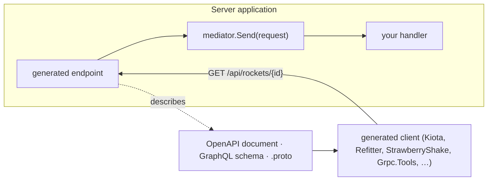

LaunchPad's API generators turn mediator requests into a server. You list the requests an **operation host** exposes, and the generator
writes the endpoints, each of which sends its request through your mediator. Clients are generated the usual way, from what the server
describes: its OpenAPI document, its GraphQL schema or its `.proto`.



The generators work with [martinothamar/Mediator](https://github.com/martinothamar/Mediator), ChannelMediator, Immediate.Handlers,
Foundatio.Mediator and ZeroAlloc.Mediator. They are incremental source generators: nothing is found by reflection or by
scanning assemblies, and the generated Minimal API endpoints are native AOT safe.

This page covers the Minimal API, MVC controller, gRPC (code-first and proto-first) and GraphQL (mutations) servers, and generating clients for them.

## Packages

The generators ship in `Rocket.Surgery.LaunchPad.Foundation`, next to LaunchPad's other source generators, so a project that references
Foundation has them: the attributes (`[ApiOperation]`, `[Operation<T>]`, …), host checks, code fixes, and the generators for Minimal API
(`*Endpoints`), MVC (`*Controller`), gRPC (`*Service`) and GraphQL (`*Mutations`). Reference Foundation from the servers and from contracts
that customise their operations.

The attributes are generated into each project that uses them, as `internal` types, so nothing reaches your runtime dependencies. One
generator per transport runs in every project that references Foundation, and each writes code only for the hosts of its kind, using that
transport's library (ASP.NET Core, protobuf-net.Grpc or HotChocolate). Why they share Foundation's analyzer is recorded in
[ADR 0004](https://github.com/RocketSurgeonsGuild/LaunchPad/blob/main/docs/adr/0004-one-generator-assembly.md).

## Quick start

**Contracts**: plain mediator requests. Nothing is required: XML documentation becomes the OpenAPI summary, `[ApiOperation]` adds metadata
to the operation, and `[Creates]` marks a response that identifies a new resource.

```csharp
namespace Rockets.Contracts;

public static class GetRocket
{
    /// <summary>Load a rocket.</summary>
    public sealed record Request(Guid Id) : IRequest<RocketModel?>;
}

public static class CreateRocket
{
    public sealed record Request(string Name) : IRequest<Response>;

    [Creates(typeof(GetRocket.Request))]   // answers 201 with a Location for GetRocket
    public sealed record Response(Guid Id);
}
```

**Server**: a `static partial` class named `*Endpoints`, one attribute per operation.

```csharp
[Operation<GetRocket.Request>]
[Operation<ListRockets.Request>]
[Operation<CreateRocket.Request>]
[Operation<EditRocket.Request>]
[Operation<DeleteRocket.Request>]
public static partial class RocketsEndpoints;

// Program.cs
builder.Services.AddOpenApi();
app.MapOpenApi();            // /openapi/v1.json, for the clients
app.MapRocketsEndpoints();   // returns the RouteGroupBuilder for /api/rockets
```

**Client**: generated from the server's OpenAPI document by the tool of your choice. See [Generating clients](#generating-clients).

## Operation hosts

An operation host is a top-level `partial` type. The generator writes complete members into it, with signatures it chooses. A host lists
every operation it exposes, so nothing becomes public by accident ([ADR-0003](https://github.com/RocketSurgeonsGuild/LaunchPad/blob/main/docs/adr/0003-explicit-operation-hosts.md)).

The transport comes from the host itself; the first rule that matches wins:

| The host…                                      | Transport                |
| ---------------------------------------------- | ------------------------ |
| derives a Grpc.Tools service base              | proto-first gRPC server  |
| derives from `ControllerBase`                  | MVC controller           |
| has `[ExtendObjectType(Query)]` / `(Mutation)` | GraphQL query / mutation |
| is named `*Controller`                         | MVC controller           |
| is named `*Endpoints` or `*Api`                | Minimal API              |
| is named `*Service`                            | gRPC server              |
| is named `*Queries` / `*Mutations`             | GraphQL                  |

A host that matches nothing, or whose transport's library isn't referenced, is LPAD1017. A Minimal API host must be `static partial` and
any other host `partial`; LPAD1010 has a code fix that adds the modifiers.

### Names, groups and routes

- The **operation name** comes from the request: `GetRocket.Request` and `GetRocketRequest` are both `GetRocket`. A nested type named only by
  a verb takes its container's noun: `EditRocket.PatchRequest` is `PatchRocket`. The name is the endpoint name and OpenAPI operation id, the
  gRPC method and (camelCased) the GraphQL field, so it's also the method name in generated clients.
- The **group** is the host name without its suffix, in kebab-case: `RocketsEndpoints` and `RocketsService` are both `rockets`. Set
  `[OperationHost(Group = "...")]` to choose another.
- The **route** is `RoutePrefix / group / path`. The prefix defaults to `api`. The path is REST style: the verb prefix and the group noun are
  dropped from the operation name, and `{id}` comes first when the request has an `Id`. Tokens get the constraint of their member's
  type (`{id:guid}` for a `Guid`, or for a strongly typed id whose `Value` is one); a `Route` you write is used as written.

| Operation (group `rockets`) | Verb and route                         | Success |
| --------------------------- | -------------------------------------- | ------- |
| `ListRockets`               | `GET /api/rockets`                     | 200     |
| `GetRocket`                 | `GET /api/rockets/{id}`                | 200     |
| `CreateRocket`              | `POST /api/rockets`                    | 201     |
| `EditRocket`                | `PUT /api/rockets/{id}`                | 200     |
| `PatchRocket`               | `PATCH /api/rockets/{id}`              | 200     |
| `DeleteRocket`              | `DELETE /api/rockets/{id}`             | 204     |
| `GetRocketLaunchRecords`    | `GET /api/rockets/{id}/launch-records` | 200     |

Verbs come from the name's prefix: `Get`/`Find`/`List`/`Search`… are GET, `Create`/`Add`/`New`… are POST (201), `Edit`/`Update`/`Save`… are
PUT, `Patch` is PATCH, `Delete`/`Remove`/`Cancel`… are DELETE (204), and anything else is POST. Two operations with the same verb and
route are LPAD1008.

### Customising an operation

Named arguments on `[Operation<T>]` win over `[ApiOperation]` on the request, which wins over the rules above:

```csharp
[OperationHost(Group = "fleet", RoutePrefix = "api/v2")]
[Operation<SearchRockets.Request>(Policy = new[] { "rockets.read" }, Summary = "Search")]
[Operation<LaunchRocket.Request>(Route = "{id}/launch", Roles = new[] { "pilot" })]
public static partial class FleetEndpoints
{
    // Optional hooks, one per operation; unimplemented ones compile away.
    static partial void ConfigureSearchRockets(IEndpointConventionBuilder endpoint) => endpoint.CacheOutput();
}
```

| On `[Operation<T>]`                                          | Effect                                                                              |
| ------------------------------------------------------------ | ----------------------------------------------------------------------------------- |
| `Route`, `Verb`, `Name`                                      | Override the path, verb and endpoint name.                                          |
| `Summary`, `Description`, `Tags`                             | OpenAPI metadata.                                                                   |
| `Policy`, `Roles`, `AuthenticationSchemes`, `AllowAnonymous` | Authorization on the endpoint.                                                      |
| `Input`                                                      | Bind a transport-specific input type and convert it with its `Create()` (LPAD1020). |
| `Version`                                                    | The API version of the operation, overriding the host's (see below).                |

`[Creates(typeof(TRequest))]` (or `[Creates<TRequest>]` where generic attributes are available) on a response type makes every operation that
returns it answer `201 Created`, with a `Location` header for `TRequest`'s GET operation, filled from the response's members
(`CreateRocket.Response.Id` → `{id}`). The target is looked for on the same host first, then on any other host of the same transport. When no
host exposes it, or a route value has no matching member, the operation still answers 201, without a `Location`, and LPAD1023 says why.

Summaries and descriptions come from, in order: the operation's `Summary`/`Description`, `[ApiOperation]`, and the `<summary>`/`<remarks>` of
the request type or of the type that contains it (`GetRocket` for `GetRocket.Request`). For a request in a referenced project, the base
package's build targets hand that project's XML documentation file to the generators, so turn on `GenerateDocumentationFile` there. A
contracts package can be added with `<AdditionalFiles Include="path/to/Contracts.xml" LaunchPadApiDocumentation="true" />`.

### API versions

`[OperationHost(Version = "1.0")]` gives every operation of the host an API version, and `[Operation<T>(Version = "2.0")]` overrides it for
one operation. The server maps them with [Asp.Versioning](https://github.com/dotnet/aspnet-api-versioning); clients send the version in the
`api-version` query string, Asp.Versioning's default reader.

```csharp
[OperationHost(Version = "1.0")]
[Operation<GetRocket.Request>(Version = "2.0")]
[Operation<CreateRocket.Request>]
public static partial class RocketsEndpoints;

builder.Services.AddApiVersioning();
app.MapRocketsEndpoints();
```

- **Minimal API** hosts build one version set from the versions of their operations and map each endpoint to its own version
  (`WithApiVersionSet`, `MapToApiVersion`). Reference `Asp.Versioning.Http` and call `AddApiVersioning()`.
- **Controller** hosts get an `[ApiVersion]` per version on the class and `[MapToApiVersion]` on each action. Reference `Asp.Versioning.Mvc`
  and call `AddApiVersioning().AddMvc()`.

A request for a version the endpoint isn't mapped to, or with no version, answers 400 with Asp.Versioning's problem details. To accept
unversioned requests, set `AssumeDefaultVersionWhenUnspecified` and `DefaultApiVersion` in `AddApiVersioning(options => ...)`. Without
the package for the host's transport (`Asp.Versioning.Http` for Minimal API, `Asp.Versioning.Mvc` for controllers), versions aren't mapped
and LPAD1024 warns. gRPC and GraphQL hosts have no API versions; `Version` on them is LPAD1021.

### MVC controllers

A `partial` class named `*Controller` (or deriving from `ControllerBase`) gets one action per operation, on the same routes as a Minimal API
host would:

```csharp
[Operation<GetRocket.Request>]
[Operation<CreateRocket.Request>]
public partial class RocketsController;   // → [ApiController, Route("api/rockets")] RocketsController : ControllerBase

// Program.cs
builder.Services.AddControllers();
app.MapControllers();
```

- The generator adds `[ApiController]`, `[Route("{RoutePrefix}/{Group}")]` and the `ControllerBase` base only when the host doesn't declare
  them. A host's own `[Route]` replaces prefix and group (`[controller]` is the host's noun), and its hand-written actions, filters and
  attributes stay as they are.
- Actions return MVC results, so responses use MVC's formatters and `AddJsonOptions` settings, and carry `[ProducesResponseType]` for
  ApiExplorer. Binding failures answer 400 through `[ApiController]`.
- The mediator is resolved inside the action, so the host's constructor is yours.
- MVC only discovers `public` controllers.

### gRPC

A `partial` class named `*Service` becomes a code-first gRPC service with [protobuf-net.Grpc](https://protobuf-net.github.io/protobuf-net.Grpc/).
The generator writes its contract too (a `[Service]` interface, one operation per request), so the contracts project needs no gRPC reference.

```csharp
[Operation<GetRocket.Request>]
[Operation<ListRockets.Request>]
public partial class RocketsService;

builder.Services.AddCodeFirstGrpc();
app.MapRocketsService();

// With protobuf-net.Grpc.Reflection referenced: the .proto to generate clients from.
File.WriteAllText("rockets.proto", RocketsService.GetProto());
```

- The service is `{package}.{Service}`: the group as the package and in PascalCase as the service, so `rockets.Rockets` and routes such as
  `/rockets.Rockets/GetRocket`, whatever the server's C# namespace.
- The whole request is the message: route, query and header binding don't apply.
- Requests and responses need `[DataContract]` with ordered `[DataMember]`s, or `[ProtoContract]` (LPAD1014). Positional records work: the
  generated code lets protobuf-net create them without a parameterless constructor.
- Nested types are named with their container (`CreateRocketRequest`), so the many `X.Request` types don't all become `message Request`.
- Messages use protobuf-net's compatibility level 300: a `Guid` or `decimal` travels as a `string`, a `DateTime` as
  `google.protobuf.Timestamp` and a `TimeSpan` as `google.protobuf.Duration`, the types a `.proto` declares, not protobuf-net's
  `bcl.proto` messages.
- protobuf-net.Grpc only carries classes. A struct request or response (ZeroAlloc's requests) goes in a wrapper the generator writes, which
  protobuf-net replaces by the struct itself on the wire, so its message is the struct's. A primitive response (`bool`) travels in a
  one-field message. Void operations answer `google.protobuf.Empty`.
- A `null` response answers `NotFound`. Streams are server streaming.
- `GetProto()` is generated when the server references `protobuf-net.Grpc.Reflection`.

### Proto-first gRPC

A `partial` class that derives the service base Grpc.Tools generates from a `.proto` (`Rockets.RocketsBase`) is a proto-first gRPC service,
whatever its name. The `.proto` is yours: the generator overrides the rpc of each listed operation, matched by name, mapping the proto
request to the operation's request, sending it through the mediator and mapping the response back. Rpcs that no operation lists keep the
base class's `Unimplemented` answer, so you can write them by hand.

```proto
service Rockets {
  rpc GetRocket (GetRocketRequest) returns (RocketReply);
  rpc ListRockets (ListRocketsRequest) returns (stream RocketReply);
  rpc DeleteRocket (DeleteRocketRequest) returns (google.protobuf.Empty);
}
```

```csharp
[Operation<GetRocket.Request>]
[Operation<ListRockets.Request>]
[Operation<DeleteRocket.Request>]
public partial class RocketsService : Rockets.RocketsBase;

// The mappings, written by ZeroAlloc.Mapping.
[Map<GetRocketRequest, GetRocket.Request>]
[Map<ListRocketsRequest, ListRockets.Request>]
[Map<DeleteRocketRequest, DeleteRocket.Request>]
[Map<RocketModel, RocketReply>]
public static partial class RocketMappings
{
    // A proto message is filled in place: it has settable properties and no constructor parameters.
    public static partial void Map(RocketModel src, RocketReply existingDst);
}

builder.Services.AddGrpc();
app.MapRocketsService();
```

- Compile the `.proto` with Grpc.Tools (`<Protobuf Include="rockets.proto" GrpcServices="Server" />`, from `Grpc.AspNetCore`) and reference
  [ZeroAlloc.Mapping](https://mapping.zeroalloc.net) (LPAD1041 without it).
- An operation is matched to the rpc of its name, or of its `[Operation<T>(Name = "…")]`; LPAD1040 when there is none. A unary or void
  operation needs a unary rpc and a stream operation a server streaming rpc (LPAD1042); client and bidirectional streaming aren't supported.
- You declare the mappings, on any `static partial` class in the server: `[Map<ProtoRequest, Request>]` for each request (or its `Input`
  type) and `[Map<Response, ProtoResponse>]` for each response; `[ReverseMap]` covers both directions. A mapping the generator needs and
  can't find is LPAD1043, which names the attribute to add. The generator can't declare them for you: ZeroAlloc.Mapping's generator only
  sees the code you write, not other generators' output.
- ZeroAlloc.Mapping's usual form builds the destination through its constructor, which leaves a proto message empty. For a proto message,
  declare the update-in-place form, `public static partial void Map(Response src, ProtoResponse existingDst);`, and the generator fills a new
  message through it (LPAD1044 without it).
- Nested messages, repeated fields and well-known types (`Timestamp`, a `Guid` carried as a `string`) are yours to map, with ZeroAlloc.Mapping's
  own tools: a nested `[Map]`, `[MapProperty]`, `[MapValue]` or an `[AfterMap]` hook that sets what the property matching can't.
- Void operations answer an empty response message (`google.protobuf.Empty`), and a `null` response `NotFound`.
- A union response answers its value case; an error case throws its status with its name in the `case` trailer, as on code-first hosts. The
  `case-bin` trailer carries the case only when you map it to a proto message (`[Map<NotReady, NotReadyError>]`, filled in place), so a
  client can decode it with its own copy of the `.proto`.
- `[OperationHost(Group)]` doesn't apply: the `.proto` names the service (LPAD1021).

### GraphQL mutations

A `partial` class named `*Mutations` (or with `[ExtendObjectType(OperationTypeNames.Mutation)]`) gets one HotChocolate mutation per
operation, taking the request as its single `request` argument:

```csharp
[ExtendObjectType(OperationTypeNames.Mutation)]
[Operation<CreateRocket.Request>]
[Operation<EditRocket.PatchRequest>(Input = typeof(EditRocketPatchRequest))]
[Operation<DeleteRocket.Request>]
public partial class RocketMutation;

builder.Services.AddGraphQLServer().AddQueryType().AddMutationType().AddRocketMutation();
// mutation { createRocket(request: { name: "Falcon" }) { id } }
```

- Field names are the operation names in camelCase, or `[ApiOperation(GraphQLName)]`. A field declared on two mutation hosts is LPAD1009.
- `Add{Host}()` names nested inputs and responses after their container (`CreateRocketRequest`, `CreateRocketResponse`), so the many nested
  `Request` types don't collide; other inputs keep HotChocolate's `…Input` names. LaunchPad.HotChocolate's `NestedTypeNameTypeInterceptor`
  leaves those names as they are.
- A void operation answers `Boolean!` (`true`). A stream isn't a mutation (LPAD1015, skipped).
- An operation is a mutation unless its verb is GET; one inferred as a query on a mutation host is LPAD1019. Set
  `[ApiOperation(GraphQLOperation = GraphQLOperation.Mutation)]` to keep it.
- `Input` types work as on HTTP. An input implementing LaunchPad's `IOptionalTracking<TRequest>` gets its `Create()` from another generator,
  which counts.
- The summary (or XML documentation) is the field's description; `Policy`, `Roles` and `AllowAnonymous` become HotChocolate authorization.

**Queries aren't generated.** They usually return `IQueryable` with paging, filtering and projections, which a mediator response can't; a
`*Queries` host is LPAD1017. Write queries by hand.

## Binding and responses

- Route tokens bind to the request member of the same name; a token without a member is LPAD1003, an `[ApiRoute]` member missing from the
  route is LPAD1004.
- GET and DELETE take the other members from the query string; complex members there are LPAD1005. POST, PUT and PATCH take the whole
  request as the JSON body, and route values are applied on top (`request with { Id = id }` for records).
- Route, query and header values must be parsable: primitives, enums, `Guid`, date and time types, or anything with `IParsable<T>` or a
  static `TryParse` (LPAD1007). Strongly typed IDs work when they provide one.
- `[ApiQuery]`, `[ApiHeader]`, `[ApiBody]`, `[ApiService]` and `[ApiIgnore]` on a member override the defaults; ASP.NET Core's `[FromRoute]`
  and friends are honoured too.

| Response              | Server answers                                                                       |
| --------------------- | ------------------------------------------------------------------------------------ |
| `T`                   | 200 (201 for creates) with JSON                                                      |
| `T?`                  | the value, or 404 for `null`                                                         |
| none / `Unit`         | 204                                                                                  |
| `IAsyncEnumerable<T>` | newline-delimited JSON (`application/x-ndjson`), one item per line, flushed per item |
| a union               | its value case as above, each error case as a problem (see below)                    |

A binding failure answers 400, with a ProblemDetails body when the application calls `AddProblemDetails()`. Generated endpoints describe
their parameters, bodies and responses to ApiExplorer, so OpenAPI documents them like hand-written ones.

### Union responses

A handler can return a union response, its value case and its error cases, instead of throwing (ADR-0006). A union is a C# 15 union: a
`union` declaration, or the same shape written by hand (see the [union types design](https://github.com/RocketSurgeonsGuild/LaunchPad/blob/main/docs/design/union-types.md)). The generators know it by `System.Runtime.CompilerServices.UnionAttribute` or `IUnion`. Its case types
are the parameter types of its public one-parameter constructors. An error case is known by its name or by `[ApiError]`; the value case is
the first case that is neither, and a union has exactly one.

LaunchPad's standard problem cases in `Rocket.Surgery.LaunchPad.Foundation` (`NotFound`, `Invalid`, `UnprocessableEntity`, `Unauthorized`, `Forbidden`,
`Conflict`) match the name rules below. A union may list `Problem` itself as a case: it answers each standard case by its runtime type, and
any other problem as 500. A problem's detail, title, link, instance and properties fill the transport's error shape (below).

```csharp
public sealed record RocketNotFound(Guid Id);
[ApiError(422, GrpcStatus = 9, GraphQLCode = "UNPROCESSABLE")] public sealed record NotReady(string Reason);

public union LaunchRocketResult(RocketModel, RocketNotFound, NotReady);
public static class LaunchRocket { public sealed record Request(Guid Id) : IRequest<LaunchRocketResult>; }
```

The value case answers like a plain response: 200, 201 with `[Creates]`, 204 for a unit (`Unit`, `ValueTuple`), 404 when it or the union
(`LaunchRocketResult?`) is nullable and null. An error case's status comes from `[ApiError]` on its type, or else from its name, ignoring an `Error`, `Exception`, `Problem`,
`Failure` or `Result` ending:

| Name starts or ends with            | HTTP | gRPC                 | GraphQL code      |
| ----------------------------------- | ---- | -------------------- | ----------------- |
| `NotFound`                          | 404  | `NotFound`           | `NOT_FOUND`       |
| `Unauthorized`, `Unauthenticated`   | 401  | `Unauthenticated`    | `UNAUTHENTICATED` |
| `Forbidden`                         | 403  | `PermissionDenied`   | `FORBIDDEN`       |
| `Conflict`                          | 409  | `FailedPrecondition` | `CONFLICT`        |
| `Validation`, `UnprocessableEntity` | 422  | `InvalidArgument`    | `BAD_USER_INPUT`  |
| `Invalid`                           | 400  | `InvalidArgument`    | `BAD_USER_INPUT`  |

`[ApiError(statusCode)]` sets the HTTP status; its gRPC status and GraphQL code default to the ones for that status. A second case that
matches no name and has no `[ApiError]` is LPAD1028. Each transport carries the case name, so cases that share a status stay distinct:

- **HTTP**: ProblemDetails (`application/problem+json`) with the status, the case name in a `case` extension and the case's members as
  camel-cased extensions; a problem's detail, title, link (as `type`) and instance fill those fields and its properties are extensions.
  In OpenAPI each status has a schema per case, keyed on `case` (see [OpenAPI documents](#openapi-documents)).
- **gRPC**: an `RpcException` with the status, the case name in the `case` trailer and the case, serialized by protobuf-net, in the
  `case-bin` trailer (left out for a case without members). A problem's detail is the status message and it has no `case-bin`. A case with members needs `[DataContract]` or `[ProtoContract]` (LPAD1014), and
  `GetProto()` declares its message.
- **GraphQL**: an error whose `extensions.code` is the code from the table (or `[ApiError(GraphQLCode)]`), with the case name in
  `extensions.case` and the case's members as extensions. A problem's detail is the error message and its properties are extensions. The
  codes follow the convention most GraphQL servers and clients use.

A stream of unions (`IAsyncEnumerable<LaunchRocketResult>`) streams its value cases and ends with the first error case: over HTTP, as the
response's ProblemDetails when nothing was written yet, otherwise as a last NDJSON line holding the problem; over gRPC, as the `RpcException`
above. GraphQL hosts skip streams (LPAD1015).

A `null` response still answers 404 for a nullable response that isn't a union. Throwing is not a way to report a failure: LaunchPad has no
exceptions, filters or interceptors that turn an exception into a 404 or a 400 any more, so an exception a handler throws answers as an
unexpected error (500 over HTTP).

### OpenAPI documents

Generated endpoints describe themselves to ApiExplorer, so `AddOpenApi()` documents them like hand-written ones: the endpoint name is the
operation id, the XML summary and remarks (or `Summary` and `Description`) the summary and description, and every status the endpoint
answers is a response. An operation with `Policy`, `Roles` or `AuthenticationSchemes` (and without `AllowAnonymous`) also lists 401 and 403.

When the server references Microsoft.AspNetCore.OpenApi, each endpoint also gets a generated operation transformer for what metadata can't
say. It is registered on the endpoint itself: `Map{Host}()` calls `AddOpenApiOperationTransformer`, and a controller action carries a
convention attribute that adds the same metadata to the action. The application registers nothing, and nothing is read by reflection when the
document is built.

- **Union cases.** Each error status of a union response is a `oneOf` of one schema per case, with a discriminator on `case`. A case's
  schema, `{Case}Problem` in the components, is the ProblemDetails with `case` (an enum of the case name) and the case's members:

    ```yaml
    RocketNotFoundProblem:
        allOf:
            - $ref: '#/components/schemas/ProblemDetails'
            - type: object
              required: [case]
              properties:
                  case: { type: string, enum: [RocketNotFound] }
                  id: { type: string, format: uuid }
    ```

    A 400 that the endpoint also answers for a value it can't bind keeps its plain ProblemDetails schema, since that problem has no case.

- **Created.** A `[Creates]` response's 201 has a `Location` header.
- **Authorization.** The 401 has a `WWW-Authenticate` header.
- **XML documentation.** The summaries of the request type, its response type and each union error case describe their schemas, and
  their properties' summaries describe the properties and the route, query and header parameters. A positional record's property without
  a summary of its own takes the record's `<param>` for it, so `/// <param name="Id">The rocket's id.</param>` is enough. LaunchPad's standard
  problem cases (`NotFound`, `Forbidden`, …) are described from their own documentation. A description something else already set (another
  transformer, `[Description]`) stays. Types from another project or package are documented when the build hands their XML file over: the
  base package's targets do it for project references and LaunchPad's packages; add a contracts package's file with
  `<AdditionalFiles Include="path/to/Contracts.xml" LaunchPadApiDocumentation="true" />`.
- **Validation rules.** ZeroAlloc.Validation rules on the request's members are read at compile time and written into the request body's
  schema or the route, query and header parameters:

    | Rule                                                                  | Schema                                     |
    | --------------------------------------------------------------------- | ------------------------------------------ |
    | `[NotNull]`                                                           | required                                   |
    | `[NotEmpty]`                                                          | required, `minLength: 1` (`minItems: 1`)   |
    | `[MinLength]`, `[MaxLength]`, `[Length]`                              | `minLength`/`maxLength` (items for a list) |
    | `[InclusiveBetween]`, `[GreaterThanOrEqualTo]`, `[LessThanOrEqualTo]` | `minimum`/`maximum`                        |
    | `[ExclusiveBetween]`, `[GreaterThan]`, `[LessThan]`                   | `exclusiveMinimum`/`exclusiveMaximum`      |
    | `[Matches]`                                                           | `pattern`                                  |
    | `[EmailAddress]`                                                      | `format: email`                            |
    | `[IsEnumName(typeof(E))]`                                             | `enum` of `E`'s names                      |

    A rule with `When` or `Unless` holds only sometimes and is left out, as are rules a schema can't state (`[Must]`, `[ValidateWith]`, custom
    and async rules, `[PrecisionScale]`, `[Equal]`, `[NotEqual]`, `[Null]`, `[Empty]`). The rules constrain the request type's schema in the
    components, so every operation that carries the type shows them. A member whose schema is a shared reference (a strong type) keeps it.

Strong types are described by the Primitives package's own transformer (see [strong types](../../concepts/strong-types/)). LaunchPad's
OpenAPI filters for hand-written endpoints (`OpenApiJoint`: operation ids, parameter names, the 201 header, the 401/403 header, media types)
skip generated endpoints, which carry `GeneratedCodeAttribute` metadata with the tool `Rocket.Surgery.LaunchPad.Api`.

## Generating clients

The generators don't write clients. Each server describes itself in a standard format, and any client generator for that format works:

| Server      | Spec                                                                      | Client generators                                                    |
| ----------- | ------------------------------------------------------------------------- | -------------------------------------------------------------------- |
| Minimal API | OpenAPI: `AddOpenApi()` and `MapOpenApi()` (Microsoft.AspNetCore.OpenApi) | Kiota, Refitter (both through [Chirograph][chirograph]), …           |
| Controllers | OpenAPI, the same way                                                     | the same                                                             |
| gRPC        | `.proto`: `{Host}.GetProto()`                                             | Grpc.Tools (`<Protobuf GrpcServices="Client" />`), any protoc plugin |
| Proto-first | the `.proto` you wrote                                                    | the same                                                             |
| GraphQL     | SDL: HotChocolate serves it at `/graphql?sdl`                             | StrawberryShake, graphql-codegen, …                                  |

Write the spec at build or in CI, for example from a small console app or test that starts the server with `TestServer` and saves
`/openapi/v1.json`, `/graphql?sdl` and `GetProto()`, then point the client generator at the files. LaunchPad's own functional tests do that
(`test/Api/Functional/Clients`): a Kiota client (through [Chirograph][chirograph]), Grpc.Tools and StrawberryShake clients, generated
from the specs on every build. The sample tests generate Refitter clients through Chirograph straight from the sample servers' projects.

[chirograph]: https://rocketsurgeonsguild.github.io/Chirograph/

For an OpenAPI client, [Chirograph](https://rocketsurgeonsguild.github.io/Chirograph/) is an MSBuild SDK that generates a Kiota or
Refitter client at build, from a document file, a URL or a server project in the same build, with an `Add<ClientName>()` registration:

```xml
<Project Sdk="Microsoft.NET.Sdk">
  <Sdk Name="Chirograph" />
  <ItemGroup>
    <OpenApiClient Include="../Rockets.Api/Rockets.Api.csproj" Generator="Refitter" ClientName="RocketsClient" />
  </ItemGroup>
</Project>
```

Pin its version under `msbuild-sdks` in `global.json`.

Things to know:

- **Nested request types.** Microsoft.AspNetCore.OpenApi names a schema after the type's simple name, so `GetRocket.Request` and
  `CreateRocket.Request` would both be `Request`. LaunchPad's OpenAPI joint (Rocket.Surgery.LaunchPad.AspNetCore) names them with their
  container (`CreateRocketRequest`); an application that calls `AddOpenApi()` itself does the same:

    ```csharp
    builder.Services.AddOpenApi(options => options.CreateSchemaReferenceId = type =>
        type.Type.DeclaringType is { } outer && !type.Type.IsGenericType
            ? outer.Name + type.Type.Name
            : OpenApiOptions.CreateDefaultSchemaReferenceId(type));
    ```

- **Streams.** OpenAPI documents a stream as `application/x-ndjson`, which most generated clients don't read: they expect one JSON array.
  Read the response yourself, one JSON item per line.
- **Struct requests.** System.Text.Json builds a struct through its parameterless constructor, so OpenAPI doesn't mark its positional members
  required the way it does a record class's. Add `[Required]` to keep generated clients non-nullable.
- **StrawberryShake** declares a local named `request` in each generated operation, so a variable named `$request` doesn't compile (CS0136).
  Name the variable something else: `mutation CreateRocket($rocket: CreateRocketRequest!) { createRocket(request: $rocket) { id } }`.

## Mediator profiles

The generators find your mediator from the libraries the project references. Exactly one of the five built-in profiles must match, or you
declare one (LPAD1002):

| Mediator               | Requests                                                                                                     | Server dispatches through       |
| ---------------------- | ------------------------------------------------------------------------------------------------------------ | ------------------------------- |
| martinothamar/Mediator | `IRequest<T>`, `ICommand<T>`, `IQuery<T>`, `ICommand` and stream variants                                    | `ISender`                       |
| ChannelMediator        | `IRequest<T>`, `IRequest`, `IStreamRequest<T>`                                                               | `IMediator`                     |
| Immediate.Handlers     | anything; the response comes from the `[Handler]` (a bare `ValueTask` is void) or `[ApiOperation(Response)]` | `IHandler<TRequest, TResponse>` |
| Foundatio.Mediator     | optional `IRequest<T>`/`ICommand<T>`/`IQuery<T>`, or `ICommand` for void, else `[ApiOperation(Response)]`    | `IMediator.InvokeAsync`         |
| ZeroAlloc.Mediator     | `IRequest<T>`, `IRequest`, `IStreamRequest<T>`                                                               | its generated `IMediator`       |

Requests that implement no marker interface (Immediate.Handlers, and optionally Foundatio) name their response with
`[ApiOperation(Response = typeof(...))]`. `typeof` can't say "nullable", so for Immediate.Handlers the server takes the nullability from its
`[Handler]` method when that is next to the request or the host.

### A custom profile

Another mediator can be described with two assembly attributes:

```csharp
[assembly: MediatorProfile(SenderType = typeof(IMyDispatcher), SendMethod = "Dispatch", StreamMethod = "Stream", Name = "MyMediator")]
[assembly: MediatorRequest(typeof(IMyRequest<>), HandlerInterface = typeof(IMyHandler<,>), HandleMethod = "Handle")]
[assembly: MediatorRequest(typeof(IMyStream<>), Kind = RequestKind.Stream)]
```

A profile without a `SenderType` dispatches through each request kind's `HandlerInterface`. An operation the profile can't dispatch is
skipped (LPAD1016).

## Patch operations

A patch operation's request carries only the changes to another operation's request: it implements `IPropertyTracking<TRequest>`, and
the property tracking generator gives it an `Assigned<T>` member for each property of `TRequest` and an `ApplyChanges` method. Its handler
is generated too. Declare the handler class `partial`, with the mediator's handler interface and the services it needs, including the
mediator's sender, and implement `GetRequest`, which loads the current request:

```csharp
public partial record PatchRequest : IRequest<RocketModel>, IPropertyTracking<Request>
{
    public RocketId Id { get; init; }
}

internal partial class EditRocketHandler(RocketDbContext dbContext, IMediator mediator)
    : IRequestHandler<Request, RocketModel>, IRequestHandler<PatchRequest, RocketModel>
{
    public async ValueTask<RocketModel> Handle(Request request, CancellationToken cancellationToken) => /* ... */;

    private partial async ValueTask<Request> GetRequest(PatchRequest request, CancellationToken cancellationToken) =>
        MapRequest(await dbContext.Rockets.SingleAsync(z => z.Id == request.Id, cancellationToken));
}
```

`GetRequest` returns a request, so it can't answer an error case. When the entity can be missing and the operation answers a union,
implement the patch's handle method yourself; the generator writes nothing for a handler that already has one:

```csharp
public async ValueTask<Result> Handle(PatchRequest request, CancellationToken cancellationToken)
{
    if (await dbContext.Rockets.FindAsync([request.Id], cancellationToken) is not { } rocket) return new NotFound($"Rocket {request.Id} was not found");
    return await mediator.Send(request.ApplyChanges(MapRequest(rocket)), cancellationToken);
}
```

The generated handle method applies the patch to that request and sends the result through the mediator, so the full request is validated
like any other. The handle method's shape (`Task<T>` or `ValueTask<T>`, the cancellation token) comes from the mediator's handler
interface, and the handler interface is written in your source, so a mediator's own source generator (Mediator, ZeroAlloc.Mediator) still
finds the handler. A profile without a sender (Immediate.Handlers) can't send the patched request (LPAD1025). Foundatio's requests have
no handler interface, so it has no patch handlers: a handler that declares `GetRequest` there is LPAD1029; write its handle method yourself.

## Native AOT

Generated Minimal API endpoints don't rely on the Request Delegate Generator (which can't see generated code): they parse route, query and
header values, read the body and write the result through the application's `JsonTypeInfo`. A native AOT application supplies a
`JsonSerializerContext`:

```csharp
builder.Services.AddJsonTypeInfoResolver(RocketsJsonContext.Default);
// or, without LaunchPad's SystemTextJsonJoint:
builder.Services.ConfigureHttpJsonOptions(o => o.SerializerOptions.TypeInfoResolverChain.Insert(0, RocketsJsonContext.Default));
```

LaunchPad's nested `X.Request` types share a simple name, so each `[JsonSerializable]` entry needs its own `TypeInfoPropertyName`; without it,
SYSLIB1031 silently skips the type. In a project that sets `PublishAot`, `IsAotCompatible`, `PublishTrimmed` or `IsTrimmable` (or
`LaunchPadApiRequireJsonContext`), LPAD1030 names each body and response type no context in the project or its references declares, or
reaches through its properties and collections. Its code fix writes the missing entries, each with a `TypeInfoPropertyName`, onto the
project's own context, or creates one beside the host when the project has none (chain a created context in yourself). See [JSON and native AOT](../json-and-native-aot/). In an AOT application, `Configure{Operation}` receives an `IEndpointConventionBuilder`, and endpoint
filters don't apply. `test/Api/Aot` publishes such a server with `PublishAot` and checks it with a round trip over HTTP.

## Diagnostics

| ID       | Severity | Meaning                                                                                               |
| -------- | -------- | ----------------------------------------------------------------------------------------------------- |
| LPAD1001 | Error    | The request matches no request kind of the profile and has no `Response`.                             |
| LPAD1002 | Error    | No mediator profile, or several built-in ones match.                                                  |
| LPAD1003 | Error    | A route token has no matching member.                                                                 |
| LPAD1004 | Error    | An `[ApiRoute]` member isn't in the route.                                                            |
| LPAD1005 | Error    | A complex member is bound from the route or query string.                                             |
| LPAD1006 | Error    | The request can't be built from the bound values.                                                     |
| LPAD1007 | Error    | A route, query or header member isn't parsable.                                                       |
| LPAD1008 | Error    | Two operations share a verb and route.                                                                |
| LPAD1009 | Error    | A GraphQL field is declared on two mutation hosts.                                                    |
| LPAD1010 | Error    | The host isn't `partial` (Minimal API: `static partial`). Has a code fix.                             |
| LPAD1014 | Warning  | A gRPC request or response has no `[DataContract]` or `[ProtoContract]`.                              |
| LPAD1015 | Warning  | A stream operation on a GraphQL host is skipped.                                                      |
| LPAD1016 | Info     | An operation is skipped because the profile can't dispatch it.                                        |
| LPAD1017 | Error    | The host's transport can't be inferred, or its library isn't referenced.                              |
| LPAD1019 | Error    | A query operation is listed on a mutation host.                                                       |
| LPAD1020 | Error    | An `Input` type has no parameterless `Create()` returning the request.                                |
| LPAD1021 | Warning  | An `[OperationHost]` setting doesn't apply to the host's transport.                                   |
| LPAD1023 | Warning  | A `[Creates]` response has no reachable location target; it answers 201 without a `Location`.         |
| LPAD1024 | Warning  | An operation has an API version, but the server lacks the Asp.Versioning package for its transport.   |
| LPAD1025 | Error    | A patch handler has no constructor parameter, field or property of the mediator's sender type.        |
| LPAD1026 | Error    | A patch handler is nested in a type that isn't `partial`.                                             |
| LPAD1027 | Error    | A patch handler's interface doesn't return `Task<T>` or `ValueTask<T>`.                               |
| LPAD1028 | Error    | A union has a case besides its value case that has no status: no name rule and no `[ApiError]`.       |
| LPAD1029 | Error    | A patch handler is for a mediator with no handler interface (Foundatio), so its method isn't written. |
| LPAD1030 | Warning  | A trimmed or AOT project has a Minimal API body or response type no `JsonSerializerContext` declares. |
| LPAD1040 | Error    | A proto-first host lists an operation its service base has no rpc for.                                |
| LPAD1041 | Error    | A proto-first host is in a project that doesn't reference ZeroAlloc.Mapping.                          |
| LPAD1042 | Error    | An operation doesn't fit its rpc: unary to unary, stream to server streaming.                         |
| LPAD1043 | Error    | A mapping a proto-first operation needs isn't declared; the message names the `[Map]` to add.         |
| LPAD1044 | Error    | A mapping to a proto message has no update-in-place form, so the message would stay empty.            |

LPAD1011, LPAD1012, LPAD1013, LPAD1018 and LPAD1022 belonged to the generated clients, which were removed; the IDs aren't reused.

## Limitations

- The generators don't configure Asp.Versioning's reader: versions are read from the `api-version` query string unless you configure it.
- With Foundatio, give each request its own handler class: Foundatio's generator names its wrappers after the message's simple name, which
  nested `X.Request` types share.
