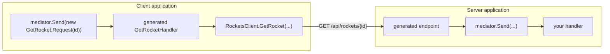

LaunchPad's API generators turn mediator requests into a transport and back. You list the requests an **operation host** exposes, and the
generator writes the endpoints on the server and a typed client, plus one mediator handler per request, on the client. The client's
`mediator.Send(request)` then reaches the server's handler over HTTP, so calling code reads the same on both sides.



The generators work with MediatR, [martinothamar/Mediator](https://github.com/martinothamar/Mediator), ChannelMediator,
Immediate.Handlers, Foundatio.Mediator and ZeroAlloc.Mediator. They are incremental source generators: nothing is found by reflection or by
scanning assemblies, and the generated server endpoints are native AOT safe.

This page covers the Minimal API, MVC controller, gRPC and GraphQL (mutations) servers and their clients.

## Packages

| Package                        | Reference it from                          | What it does                                                                                                                                                                                                                                                                                                |
| ------------------------------ | ------------------------------------------ | ----------------------------------------------------------------------------------------------------------------------------------------------------------------------------------------------------------------------------------------------------------------------------------------------------------- |
| `Rocket.Surgery.LaunchPad.Api` | contracts that customise, servers, clients | The attributes (`[ApiOperation]`, `[Operation<T>]`, …), host checks, code fixes, and the generators: Minimal API (`*Endpoints`), MVC (`*Controller`), gRPC (`*Service`, `*GrpcClient`), GraphQL (`*Mutations`, `*GraphQLClient`) and HTTP clients (`*Client`, see [placement](#where-a-client-host-lives)). |

It's an analyzer-only development dependency. The attributes are generated into each project that uses them, as `internal` types, so
nothing reaches your runtime dependencies. One generator per transport runs in every project that references the package, and each writes
code only for the hosts of its kind, using that transport's library (ASP.NET Core, protobuf-net.Grpc, HotChocolate or
Microsoft.Extensions.Http).

## Quick start

**Contracts**: plain mediator requests. Nothing is required: XML documentation becomes the OpenAPI summary, `[ApiOperation]` adds metadata
both sides should agree on, and `[Creates]` marks a response that identifies a new resource.

```csharp
namespace Rockets.Contracts;

public static class GetRocket
{
    /// <summary>Load a rocket.</summary>
    public sealed record Request(Guid Id) : IRequest<RocketModel?>;
}

public static class CreateRocket
{
    public sealed record Request(string Name) : IRequest<Response>;

    [Creates(typeof(GetRocket.Request))]   // answers 201 with a Location for GetRocket
    public sealed record Response(Guid Id);
}
```

**Server**: a `static partial` class named `*Endpoints`, one attribute per operation.

```csharp
[Operation<GetRocket.Request>]
[Operation<ListRockets.Request>]
[Operation<CreateRocket.Request>]
[Operation<EditRocket.Request>]
[Operation<DeleteRocket.Request>]
public static partial class RocketsEndpoints;

// Program.cs
app.MapRocketsEndpoints();   // returns the RouteGroupBuilder for /api/rockets
```

**Client**: a `partial` class named `*Client` listing the operations it calls.

```csharp
[Operation<GetRocket.Request>]
[Operation<CreateRocket.Request>]
public partial class RocketsClient;

// startup
services.AddMediatR(c => c.RegisterServicesFromAssemblyContaining<RocketsClient>());
services.AddRocketsClient().ConfigureHttpClient(c => c.BaseAddress = new Uri("https://rockets.example/"));

// anywhere
var created = await mediator.Send(new CreateRocket.Request("Falcon"));
var rocket = await mediator.Send(new GetRocket.Request(created.Id));   // null when the server answers 404
```

`AddRocketsClient()` registers the named `HttpClient`, the client class and one mediator handler per operation, and returns the
`IHttpClientBuilder` for the base address, handlers and resilience. You can also inject `RocketsClient` and call
`client.GetRocket(request, cancellationToken)` directly.

## Operation hosts

An operation host is a top-level `partial` type. The generator writes complete members into it, with signatures it chooses. A host lists
every operation it exposes or calls, so nothing becomes public by accident ([ADR-0003](https://github.com/RocketSurgeonsGuild/LaunchPad/blob/main/docs/adr/0003-explicit-operation-hosts.md)).

The transport comes from the host itself; the first rule that matches wins:

| The host…                                      | Transport                |
| ---------------------------------------------- | ------------------------ |
| derives from `ControllerBase`                  | MVC controller           |
| has `[ExtendObjectType(Query)]` / `(Mutation)` | GraphQL query / mutation |
| is named `*Controller`                         | MVC controller           |
| is named `*Endpoints` or `*Api`                | Minimal API              |
| is named `*Service`                            | gRPC server              |
| is named `*Queries` / `*Mutations`             | GraphQL                  |
| is named `*GrpcClient` / `*GraphQLClient`      | gRPC / GraphQL client    |
| is named `*Client`                             | HTTP client              |

A host that matches nothing, or whose transport's library isn't referenced, is LPAD1017. A Minimal API host must be `static partial` and a
client host `partial`; LPAD1010 has a code fix that adds the modifiers.

### Names, groups and routes

- The **operation name** comes from the request: `GetRocket.Request` and `GetRocketRequest` are both `GetRocket`. A nested type named only by
  a verb takes its container's noun: `EditRocket.PatchRequest` is `PatchRocket`. The name is the client method, the endpoint name and the
  OpenAPI operation id.
- The **group** is the host name without its suffix, in kebab-case: `RocketsEndpoints` and `RocketsClient` are both `rockets`. Name the
  server and client hosts alike, or set `[OperationHost(Group = "...")]` on both.
- The **route** is `RoutePrefix / group / path`. The prefix defaults to `api`. The path is REST style: the verb prefix and the group noun are
  dropped from the operation name, and `{id}` comes first when the request has an `Id`. Tokens get the constraint of their member's
  type (`{id:guid}` for a `Guid`, or for a strongly typed id whose `Value` is one); a `Route` you write is used as written.

| Operation (group `rockets`) | Verb and route                         | Success |
| --------------------------- | -------------------------------------- | ------- |
| `ListRockets`               | `GET /api/rockets`                     | 200     |
| `GetRocket`                 | `GET /api/rockets/{id}`                | 200     |
| `CreateRocket`              | `POST /api/rockets`                    | 201     |
| `EditRocket`                | `PUT /api/rockets/{id}`                | 200     |
| `PatchRocket`               | `PATCH /api/rockets/{id}`              | 200     |
| `DeleteRocket`              | `DELETE /api/rockets/{id}`             | 204     |
| `GetRocketLaunchRecords`    | `GET /api/rockets/{id}/launch-records` | 200     |

Verbs come from the name's prefix: `Get`/`Find`/`List`/`Search`… are GET, `Create`/`Add`/`New`… are POST (201), `Edit`/`Update`/`Save`… are
PUT, `Patch` is PATCH, `Delete`/`Remove`/`Cancel`… are DELETE (204), and anything else is POST. Two operations with the same verb and
route are LPAD1008.

### Customising an operation

Named arguments on `[Operation<T>]` win over `[ApiOperation]` on the request, which wins over the rules above:

```csharp
[OperationHost(Group = "fleet", RoutePrefix = "api/v2")]
[Operation<SearchRockets.Request>(Policy = new[] { "rockets.read" }, Summary = "Search")]
[Operation<LaunchRocket.Request>(Route = "{id}/launch", Roles = new[] { "pilot" })]
public static partial class FleetEndpoints
{
    // Optional hooks, one per operation; unimplemented ones compile away.
    static partial void ConfigureSearchRockets(IEndpointConventionBuilder endpoint) => endpoint.CacheOutput();
}
```

| On `[Operation<T>]`                                          | Effect                                                                              |
| ------------------------------------------------------------ | ----------------------------------------------------------------------------------- |
| `Route`, `Verb`, `Name`                                      | Override the path, verb and endpoint name.                                          |
| `Summary`, `Description`, `Tags`                             | OpenAPI metadata.                                                                   |
| `Policy`, `Roles`, `AuthenticationSchemes`, `AllowAnonymous` | Authorization on the endpoint (server only).                                        |
| `Input`                                                      | Bind a transport-specific input type and convert it with its `Create()` (LPAD1020). |
| `Version`                                                    | The API version of the operation, overriding the host's (see below).                |
| `Handlers`                                                   | `false` to generate no mediator handler (client only).                              |

`[Creates(typeof(TRequest))]` (or `[Creates<TRequest>]` where generic attributes are available) on a response type makes every operation that
returns it answer `201 Created`, with a `Location` header for `TRequest`'s GET operation, filled from the response's members
(`CreateRocket.Response.Id` → `{id}`). The target is looked for on the same host first, then on any other host of the same transport. When no
host exposes it, or a route value has no matching member, the operation still answers 201, without a `Location`, and LPAD1023 says why.

Summaries and descriptions come from, in order: the operation's `Summary`/`Description`, `[ApiOperation]`, and the `<summary>`/`<remarks>` of
the request type or of the type that contains it (`GetRocket` for `GetRocket.Request`). For a request in a referenced project, the base
package's build targets hand that project's XML documentation file to the generators, so turn on `GenerateDocumentationFile` there. A
contracts package can be added with `<AdditionalFiles Include="path/to/Contracts.xml" LaunchPadApiDocumentation="true" />`.

The client has the same kind of hook, `partial void Configure{Operation}(HttpRequestMessage request)`, plus
`static partial void ConfigureJsonOptions(JsonSerializerOptions options)` for its serializer settings.

### API versions

`[OperationHost(Version = "1.0")]` gives every operation of the host an API version, and `[Operation<T>(Version = "2.0")]` overrides it for
one operation. The server maps them with [Asp.Versioning](https://github.com/dotnet/aspnet-api-versioning), and the HTTP client sends each
operation's version in the `api-version` query string, Asp.Versioning's default reader.

```csharp
[OperationHost(Version = "1.0")]
[Operation<GetRocket.Request>(Version = "2.0")]
[Operation<CreateRocket.Request>]
public static partial class RocketsEndpoints;

builder.Services.AddApiVersioning();
app.MapRocketsEndpoints();
```

- **Minimal API** hosts build one version set from the versions of their operations and map each endpoint to its own version
  (`WithApiVersionSet`, `MapToApiVersion`). Reference `Asp.Versioning.Http` and call `AddApiVersioning()`.
- **Controller** hosts get an `[ApiVersion]` per version on the class and `[MapToApiVersion]` on each action. Reference `Asp.Versioning.Mvc`
  and call `AddApiVersioning().AddMvc()`.

A request for a version the endpoint isn't mapped to, or with no version, answers 400 with Asp.Versioning's problem details. To accept
unversioned requests, set `AssumeDefaultVersionWhenUnspecified` and `DefaultApiVersion` in `AddApiVersioning(options => ...)`. Without
the package for the host's transport (`Asp.Versioning.Http` for Minimal API, `Asp.Versioning.Mvc` for controllers), versions aren't mapped
and LPAD1024 warns. gRPC and GraphQL hosts have no API versions; `Version` on
them is LPAD1021.

### MVC controllers

A `partial` class named `*Controller` (or deriving from `ControllerBase`) gets one action per operation, on the same routes as a Minimal API
host would:

```csharp
[Operation<GetRocket.Request>]
[Operation<CreateRocket.Request>]
public partial class RocketsController;   // → [ApiController, Route("api/rockets")] RocketsController : ControllerBase

// Program.cs
builder.Services.AddControllers();
app.MapControllers();
```

- The generator adds `[ApiController]`, `[Route("{RoutePrefix}/{Group}")]` and the `ControllerBase` base only when the host doesn't declare
  them. A host's own `[Route]` replaces prefix and group (`[controller]` is the host's noun), and its hand-written actions, filters and
  attributes stay as they are.
- Actions return MVC results, so responses use MVC's formatters and `AddJsonOptions` settings, and carry `[ProducesResponseType]` for
  ApiExplorer. Binding failures answer 400 through `[ApiController]`.
- The mediator is resolved inside the action, so the host's constructor is yours.
- MVC only discovers `public` controllers.

### gRPC

A `partial` class named `*Service` becomes a code-first gRPC service with [protobuf-net.Grpc](https://protobuf-net.github.io/protobuf-net.Grpc/),
and a `partial` class named `*GrpcClient` its client. Both generate the same contract (a `[Service]` interface named after the group, one
operation per request), so the contracts project needs no gRPC reference.

```csharp
// server
[Operation<GetRocket.Request>]
[Operation<ListRockets.Request>]
public partial class RocketsService;

builder.Services.AddCodeFirstGrpc();
app.MapRocketsService();

// client
[Operation<GetRocket.Request>]
[Operation<ListRockets.Request>]
public partial class RocketsGrpcClient;

services.AddRocketsGrpcClient(options => options.Address = new Uri("https://rockets.example/"));
var rocket = await mediator.Send(new GetRocket.Request(id));   // null when the server answers NotFound
```

- The whole request is the message: route, query and header binding don't apply.
- Requests and responses need `[DataContract]` with ordered `[DataMember]`s, or `[ProtoContract]` (LPAD1014). Positional records work: the
  generated code lets protobuf-net create them without a parameterless constructor.
- A request, response or stream item that isn't a class (a struct request, a `bool` response) travels in a one-field message the generator
  wraps and unwraps, because protobuf-net.Grpc only carries classes. Void operations answer `Empty`.
- A `null` response answers `NotFound`, which the client returns as `null`. Streams are server streaming.
- `partial void Configure{Operation}(ref CallOptions options)` on the client sets headers, deadlines and credentials per call.
- An HTTP and a gRPC client host for the same requests can't share a project: the mediator would see two handlers for each request.

### GraphQL mutations

A `partial` class named `*Mutations` (or with `[ExtendObjectType(OperationTypeNames.Mutation)]`) gets one HotChocolate mutation per
operation, taking the request as its single `request` argument:

```csharp
[ExtendObjectType(OperationTypeNames.Mutation)]
[Operation<CreateRocket.Request>]
[Operation<EditRocket.PatchRequest>(Input = typeof(EditRocketPatchRequest))]
[Operation<DeleteRocket.Request>]
public partial class RocketMutation;

builder.Services.AddGraphQLServer().AddQueryType().AddMutationType().AddRocketMutation();
// mutation { createRocket(request: { name: "Falcon" }) { id } }
```

- Field names are the operation names in camelCase, or `[ApiOperation(GraphQLName)]`. A field declared on two mutation hosts is LPAD1009.
- `Add{Host}()` names nested inputs and responses after their container (`CreateRocketRequest`, `CreateRocketResponse`), so the many nested
  `Request` types don't collide; other inputs keep HotChocolate's `…Input` names. LaunchPad.HotChocolate's `NestedTypeNameTypeInterceptor`
  leaves those names as they are.
- A void operation answers `Boolean!` (`true`). A stream isn't a mutation (LPAD1015, skipped).
- An operation is a mutation unless its verb is GET; one inferred as a query on a mutation host is LPAD1019. Set
  `[ApiOperation(GraphQLOperation = GraphQLOperation.Mutation)]` to keep it.
- `Input` types work as on HTTP. An input implementing LaunchPad's `IOptionalTracking<TRequest>` gets its `Create()` from another generator,
  which counts.
- The summary (or XML documentation) is the field's description; `Policy`, `Roles` and `AllowAnonymous` become HotChocolate authorization.

**Queries aren't generated.** They usually return `IQueryable` with paging, filtering and projections, which a mediator response can't; a
`*Queries` host is LPAD1017. Write queries by hand.

A `partial` class named `*GraphQLClient` gets one method per mutation. It posts a generated document, with the selection set built from the
response type (every readable property, scalars as leaves), to its `HttpClient`, whose base address is the GraphQL endpoint:

```csharp
[Operation<CreateRocket.Request>]
public partial class RocketsGraphQLClient;

services.AddRocketsGraphQLClient().ConfigureHttpClient(c => c.BaseAddress = new Uri("https://rockets.example/graphql"));
// sends: mutation CreateRocket($request: CreateRocketRequest!) { createRocket(request: $request) { id } }
```

GraphQL errors throw `HttpRequestException` with their messages; an error with the code `NOTFOUND` (LaunchPad's error filter) returns
`null` for a nullable response. Enum values are written in HotChocolate's UPPER_SNAKE_CASE.

## Binding and responses

- Route tokens bind to the request member of the same name; a token without a member is LPAD1003, an `[ApiRoute]` member missing from the
  route is LPAD1004.
- GET and DELETE send the other members in the query string; complex members there are LPAD1005. POST, PUT and PATCH send the whole request
  as the JSON body, and route values are applied on top (`request with { Id = id }` for records).
- Route, query and header values must be parsable: primitives, enums, `Guid`, date and time types, or anything with `IParsable<T>` or a
  static `TryParse` (LPAD1007). Strongly typed IDs work when they provide one.
- `[ApiQuery]`, `[ApiHeader]`, `[ApiBody]`, `[ApiService]` and `[ApiIgnore]` on a member override the defaults; ASP.NET Core's `[FromRoute]`
  and friends are honoured too.

| Response              | Server                                   | Client                                                                        |
| --------------------- | ---------------------------------------- | ----------------------------------------------------------------------------- |
| `T`                   | 200 (201 for creates) with JSON          | the value; any failure throws `HttpRequestException` with the status and body |
| `T?`                  | `null` answers 404                       | 404 returns `null`                                                            |
| none / `Unit`         | 204                                      | completes                                                                     |
| `IAsyncEnumerable<T>` | newline-delimited JSON, flushed per item | reads items as they arrive                                                    |

A binding failure answers 400, with a ProblemDetails body when the application calls `AddProblemDetails()`. Generated endpoints describe
their parameters, bodies and responses to ApiExplorer, so OpenAPI documents them like hand-written ones.

## Mediator profiles

The generators find your mediator from the libraries the project references. Exactly one of the built-in profiles must match, or you
declare one (LPAD1002):

| Mediator               | Requests                                                                                 | Server dispatches through       | Client handlers                                                      |
| ---------------------- | ---------------------------------------------------------------------------------------- | ------------------------------- | -------------------------------------------------------------------- |
| MediatR                | `IRequest<T>`, `IRequest`, `IStreamRequest<T>`                                           | `ISender`                       | `IRequestHandler<,>`, registered by `Add{Host}()`                    |
| martinothamar/Mediator | `IRequest<T>`, `ICommand<T>`, `IQuery<T>` and stream variants                            | `ISender`                       | handler interfaces, found by Mediator's generator in the application |
| ChannelMediator        | `IRequest<T>`, `IRequest`, `IStreamRequest<T>`                                           | `IMediator`                     | `IRequestHandler<,>`, registered by `Add{Host}()`                    |
| Immediate.Handlers     | anything; the response comes from the server's `[Handler]` or `[ApiOperation(Response)]` | `IHandler<TRequest, TResponse>` | `IHandler<,>`, registered by `Add{Host}()`                           |
| Foundatio.Mediator     | optional `IRequest<T>`/`ICommand<T>`/`IQuery<T>`, else `[ApiOperation(Response)]`        | `IMediator.InvokeAsync`         | a generated `[FoundatioModule]`                                      |
| ZeroAlloc.Mediator     | `IRequest<T>`, `IRequest`, `IStreamRequest<T>`                                           | its generated `IMediator`       | `Send` overloads added to ZeroAlloc's generated mediator             |

Requests that implement no marker interface (Immediate.Handlers, and optionally Foundatio) name their response with
`[ApiOperation(Response = typeof(...))]`. `typeof` can't say "nullable", so for Immediate.Handlers the server takes the nullability from its
`[Handler]` method when that is next to the request or the host, and the client treats the response as non-nullable: a 404 throws.

### Where a client host lives

Some mediators only dispatch to handlers their own source generator sees, and source generators can't see each other's output. That decides
which project a client host goes in (LPAD1012):

- **MediatR, ChannelMediator, Immediate.Handlers**: anywhere.
- **martinothamar/Mediator** and **Foundatio**: a library that references the contracts but does _not_ run the mediator's generator. The
  application runs it and finds the generated handlers in the library.
- **ZeroAlloc**: the project that _does_ run ZeroAlloc's generator, because the generated handlers extend the mediator it writes.

The base package's build targets tell the generators which mediator generators run in a project. With Foundatio, call
`services.Add{Host}()` before `services.AddMediator()`, and if `AddMediator` is given assemblies, include the client host's; otherwise
`Add{Host}()` throws, explaining what to change.

If the server's handler is visible to the client (declared next to the request, in a contracts project the client references), the request
would have two handlers: LPAD1013 warns, and `Handlers = false` on the operation turns the generated one off.

### A custom profile

Another mediator can be described with two assembly attributes:

```csharp
[assembly: MediatorProfile(SenderType = typeof(IMyDispatcher), SendMethod = "Dispatch", StreamMethod = "Stream", Name = "MyMediator")]
[assembly: MediatorRequest(typeof(IMyRequest<>), HandlerInterface = typeof(IMyHandler<,>), HandleMethod = "Handle")]
[assembly: MediatorRequest(typeof(IMyStream<>), Kind = RequestKind.Stream)]
```

Without a `HandlerInterface`, the typed client still works but no mediator handlers are generated (LPAD1011).

## Native AOT

Generated endpoints don't rely on the Request Delegate Generator (which can't see generated code): they parse route, query and header values,
read the body and write the result through the application's `JsonTypeInfo`. A native AOT application supplies a `JsonSerializerContext`:

```csharp
builder.Services.ConfigureHttpJsonOptions(o => o.SerializerOptions.TypeInfoResolverChain.Insert(0, RocketsJsonContext.Default));

public partial class RocketsClient
{
    static partial void ConfigureJsonOptions(JsonSerializerOptions options) => options.TypeInfoResolverChain.Insert(0, RocketsJsonContext.Default);
}
```

LaunchPad's nested `X.Request` types share a simple name, so each `[JsonSerializable]` entry needs its own `TypeInfoPropertyName`; without it,
SYSLIB1031 silently skips the type. In an AOT application, `Configure{Operation}` receives an `IEndpointConventionBuilder`, and endpoint
filters don't apply.

## Diagnostics

| ID       | Severity | Meaning                                                                                             |
| -------- | -------- | --------------------------------------------------------------------------------------------------- |
| LPAD1001 | Error    | The request matches no request kind of the profile and has no `Response`.                           |
| LPAD1002 | Error    | No mediator profile, or several built-in ones match.                                                |
| LPAD1003 | Error    | A route token has no matching member.                                                               |
| LPAD1004 | Error    | An `[ApiRoute]` member isn't in the route.                                                          |
| LPAD1005 | Error    | A complex member is bound from the route or query string.                                           |
| LPAD1006 | Error    | The request can't be built from the bound values.                                                   |
| LPAD1007 | Error    | A route, query or header member isn't parsable.                                                     |
| LPAD1008 | Error    | Two operations share a verb and route.                                                              |
| LPAD1009 | Error    | A GraphQL field is declared on two mutation hosts.                                                  |
| LPAD1010 | Error    | The host isn't `partial` (Minimal API: `static partial`). Has a code fix.                           |
| LPAD1011 | Warning  | The profile has no handler interface, so no mediator handler is generated.                          |
| LPAD1012 | Error    | The client host is in the wrong project for its mediator.                                           |
| LPAD1013 | Warning  | A hand-written handler for a client operation is visible.                                           |
| LPAD1014 | Warning  | A gRPC request or response has no `[DataContract]` or `[ProtoContract]`.                            |
| LPAD1015 | Warning  | A stream operation on a GraphQL host is skipped.                                                    |
| LPAD1016 | Info     | An operation is skipped because the profile can't dispatch it.                                      |
| LPAD1017 | Error    | The host's transport can't be inferred, or its library isn't referenced.                            |
| LPAD1018 | Error    | Two client hosts generate handlers for the same operation.                                          |
| LPAD1019 | Error    | A query operation is listed on a mutation host.                                                     |
| LPAD1020 | Error    | An `Input` type has no parameterless `Create()` returning the request.                              |
| LPAD1021 | Warning  | An `[OperationHost]` setting doesn't apply to the host's transport.                                 |
| LPAD1022 | Error    | A client host declares its own constructor.                                                         |
| LPAD1023 | Warning  | A `[Creates]` response has no reachable location target; it answers 201 without a `Location`.       |
| LPAD1024 | Warning  | An operation has an API version, but the server lacks the Asp.Versioning package for its transport. |

## Limitations

- API versions are read from the `api-version` query string only. Clients don't send them in a header or media type, and the server's
  reader isn't configured by the generators.
- With Foundatio, give each request its own handler class: Foundatio's generator names its wrappers after the message's simple name, which
  nested `X.Request` types share.
- Server and client agree on routes only through their names and settings. A route changed on the server must be repeated on the client.
